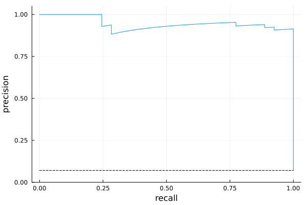

```@meta
EditURL = "notebook.jl"
```

# An Introduction to Machine Learning in Quantitative Medicine using Julia

> Anthony D. Blaom, May 2026

This tutorial presents a detailed, end-to-end application of machine learning to the
problem of creating an automated test for the presence of some disease. Specifically, we
compare several tests for hypothyroidism based on machine learning models, trained using
a well studied Garavan Institute dataset [@Quinlan_86].

We assume readers are familiar with basic statistics, including the use of
cross-validation to guard against overfitting.

The principal software tool will be the [MLJ.jl](https://juliaml.ai) machine learning
toolbox, written for the Julia programming language [@Blaom_etal_20].

[Julia](https://julialang.org) is a newer programming language with the high peformance
of older languages like FORTRAN and C, but it looks and feels like a scripting language,
such as MATLAB or Python. Julia empowers scientific domain experts, without particular
programming expertise, to rapidly prototype cutting edge solutions to their computing
needs. In Pharmacometrics modeling, for example, Pumas software [@pumas], written in
Julia, is considered best-in-class [@testament].

For resources on
learning Julia, installing Julia packages, etc, the reader is referred to the Julia
[website](https://julialang.org).

## Overview

### Class imbalance and measures of test performance

In medical binary classification tasks, such as disease screening and toxicity
detection, the training data is typically unbalanced, with many more negative outcomes
than positive ones. Additionally, naive measures of task success, such as the
proportion of correct predictions, are inappropriate; we should turn to more
nuanced metrics.

Most crucially, among subjects with hypothyroidism, we seek to reduce the number for
which our test fails to return a positive result. Equivalently, we want a high
[recall](https://en.wikipedia.org/wiki/Precision_and_recall). On the other hand, we must
also account for the tendency that higher recall means more false alarms, or a lower
[precision](https://en.wikipedia.org/wiki/Precision_and_recall), where we have
proportionally more positive tests results for which a follow up investigation is
required, despite the subject not having the disease.

The approach we take here is to fix a target recall, say 0.95, and seek the test that
will maximize the corresponding precision. Other metrics commonly used for imbalanced
data will be reported alongside this main one, the **precision at 0.95 recall.**

**Going deeper.**¹ Recall that the precision and recall of a model predicting positive or
negative outcomes can be expressed by the formulae,

$$\mathrm{recall} = 1 - \frac{\mathrm{false~negatives}}{\mathrm{positives}},$$

$$\mathrm{precision}=\frac{1}{1+(\mathrm{false~positives})/(\mathrm{true~negatives})}.$$

These metrics always lie between 0 and 1, and the higher, the better. □

### Performance of the best model

In this tutorial, we estimate the 95% confidence interval (CI) for the precision at 0.95
recall of assorted machine learning models, using 70% of the Garavan Institute dataset
to do so. Promising models are then evaluated on the remaining 30% holdout test set. For
our most promising model, a probability-predicting [support vector
machine](https://en.wikipedia.org/wiki/Support_vector_machine), the CI is 0.842 ±
0.064. This estimated CI is approximate. Generally, it is difficult to obtain good
uncertainty estimates in machine learning.

As we detail later, using a probability threshold determined from the training data
delivers a model which, on the 30% holdout set, has a **recall of 98%** and **precision
of 92%**. Additionally, the following empirical precision-recall curve suggests a
certain robustness of the precision to changes in the target recall:



> Precision-recall curve for a hypothyroidism test based on a support vector machine

### The model building workflow

The Garavan Institute dataset is actually several datasets, with varying amounts of
preprocessing. We work directly with the full "allhypo" dataset, which is unprocessed
and includes missing values. By **features** (a.k.a. covariates or inputs), we
will mean potential predictors of disease, like gender or blood test results, that are
recorded in the training dataset, and available for applying our test to new
subjects. The core algorithm that learns how to distinguish between "positive" and
"negative" test outcomes is known as a **supervised learner**. Examples you may have
encountered before are logistic regression and decision trees. However, for a complete
solution, we must wrap our learner in several other workflows to be detailed in this
tutorial:

- **missing value imputation**

- **outlier detection** and removal

- **coercion** of feature data types, to ensure correct "scientific" interpretation by
  MLJ models

- **one-hot encoding**, which transforms categorical features (such
  as the source of a referall) to continuous ones (needed in training many models)

- training of supervised models that report feature importances, with a view to applying
  **recursive feature elimination**, which can improve outcomes for other supervised
  models

- constructing model **pipelines**, which combine data pre-processing with a supervised
  learner, to streamline workflows and mitigate **data leakage**

- constructing approximate confidence intervals expected for the **predictive
  performance** of model pipelines

- **tuning** (optimization) of user-defined hyperparameters to further boost performance

- **oversampling** training data to correct for class imbalance

- **comparison** of several supervised learning models (**model selection**)

- plotting **precision-recall curves** for additional insight

- **thresholding:** transforming a probabilistic predictor into a predictor of
  point "positive"/"negative" outcomes, by determining an appropriate threshold for the
  "positive" class probability.

- **testing** the final model on a holdout test set

## Julia setup

> Launching Julia and activating an appropriate set of third-party packages.

We suppose the user is interacting with Julia using the commandline interface known as
the **REPL**. This is typically launched by running the `julia` command from a terminal
(console) window, which delivers a `julia>` prompt, after which you can enter all the
commands in this tutorial.  Before doing so, **ensure version 1.12** or higher is used
by running `juliaup default 1.12` or similar from the terminal.

Check the Julia version by entering `versioninfo()` at the `julia>` prompt. Quit the
REPL by entering `exit()` or Ctrl-D.

You can also interact with Julia using a interactive development environment such as
VSCode or emacs, or using notebook-style interfaces such as Juptyer (python-driven),
Pluto, or Nee. We do not discuss these here, except to say that Pluto's "reactive"
feature is not well-suited to machine learning applications with long training times.

### Package management

A **package environment** is a set of specific third party packages known to be
compatible with eachother and the version of Julia you are using. Typically, each
project you work on will have it's own environment, which you will want to share with
coworkers to ensure workflow reproducibility. Although you can start to learn Julia
without worrying too much about [package management](https://pkgdocs.julialang.org/v1/),
it is worth investing time understanding this excellent Julia feature before carrying
out serious work, including this tutorial.

To create a package environment compatible with the code in this tutorial, you can:

1. Clone the GitHub repository at [https://github.com/ablaom/ClassImbalanceTutorials.jl/tree/master](https://github.com/ablaom/ClassImbalanceTutorials.jl/tree/master).

2. In a fresh REPL session, edit the right-hand side of following definition to point to the root directory of your clone: `path_to_clone = "path/to/ClassImbalanceTutorials.jl/tree/master/"`.

3. Still in the REPL, run `using Pkg; Pkg.activate(path_to_local); Pkg.resolve(); Pkg.instantiate()`.

You should expect this last step to take some time, as all the software for the tutorial
is downloaded and pre-compiled.

If you encounter issues, you can try manually installing the packages you need in a new
environment, created with `Pkg.activate("my_env")`, based on the output printed below:

````@julia
using Pkg
Pkg.status()
````

````
Status `~/work/ClassImbalanceTutorials.jl/ClassImbalanceTutorials.jl/docs/src/notebooks/thyroid/Project.toml`
  [1520ce14] AbstractTrees v0.4.5
  [336ed68f] CSV v0.10.16
  [a93c6f00] DataFrames v1.8.2
  [7806a523] DecisionTree v0.12.4
  [f6006082] EvoTrees v0.18.5
  [c709b415] Imbalance v0.1.7
  [add582a8] MLJ v0.23.2
  [a7f614a8] MLJBase v1.13.0
  [c6f25543] MLJDecisionTreeInterface v0.4.4
  [094fc8d1] MLJFlux v0.6.7
  [61c7150f] MLJLIBSVMInterface v0.2.2
  [6ee0df7b] MLJLinearModels v0.10.1
  [eff96d63] Measurements v2.14.1
  [636a865e] NearestNeighborModels v0.2.3
  [262411bb] OutlierDetection v0.4.2
  [51249a0a] OutlierDetectionNeighbors v0.1.5
  [91a5bcdd] Plots v1.41.6
  [860ef19b] StableRNGs v1.0.4
  [2913bbd2] StatsBase v0.34.11
  [f43a241f] Downloads v1.7.0

````

For example, to add MLJ v0.23.2, do `Pkg.add("MLJ@0.23.2")`.²

## Models and machines

> An introduction to the principal actors in an MLJ workflow

Before considering hypothyroidism, we quickly build an MLJ model for a built-in dataset
that requires no special preprocessing, namely Fisher's famous [iris
dataset](https://en.wikipedia.org/wiki/Iris_flower_data_set). We load the dataset like
this:

````@julia
using MLJ # load the MLJ package
X_iris, y_iris = @load_iris;
````

Here `X_iris` is a table of features (relevant dimensions of the specimen) and `y_iris` an
ordinary vector representing the **target variable**, in this case the particular
species of iris. Although MLJ is not too fussy about table types, we'll convert `X_iris` to a
**dataframe**, Julia's defacto standard for tabular data:

````@julia
import DataFrames           # here `import` means function names must be qualified ...
X_iris = DataFrames.DataFrame(X_iris) # ... as in this line of code
first(X_iris, 3)                 # return the first three lines of the dataframe
````

```@raw html
<div><div style = "float: left;"><span>3×4 DataFrame</span></div><div style = "clear: both;"></div></div><div class = "data-frame" style = "overflow-x: scroll;"><table class = "data-frame" style = "margin-bottom: 6px;"><thead><tr class = "columnLabelRow"><th class = "stubheadLabel" style = "font-weight: bold; text-align: right;">Row</th><th style = "text-align: left;">sepal_length</th><th style = "text-align: left;">sepal_width</th><th style = "text-align: left;">petal_length</th><th style = "text-align: left;">petal_width</th></tr><tr class = "columnLabelRow"><th class = "stubheadLabel" style = "font-weight: bold; text-align: right;"></th><th title = "Float64" style = "text-align: left;">Float64</th><th title = "Float64" style = "text-align: left;">Float64</th><th title = "Float64" style = "text-align: left;">Float64</th><th title = "Float64" style = "text-align: left;">Float64</th></tr></thead><tbody><tr class = "dataRow"><td class = "rowLabel" style = "font-weight: bold; text-align: right;">1</td><td style = "text-align: right;">5.1</td><td style = "text-align: right;">3.5</td><td style = "text-align: right;">1.4</td><td style = "text-align: right;">0.2</td></tr><tr class = "dataRow"><td class = "rowLabel" style = "font-weight: bold; text-align: right;">2</td><td style = "text-align: right;">4.9</td><td style = "text-align: right;">3.0</td><td style = "text-align: right;">1.4</td><td style = "text-align: right;">0.2</td></tr><tr class = "dataRow"><td class = "rowLabel" style = "font-weight: bold; text-align: right;">3</td><td style = "text-align: right;">4.7</td><td style = "text-align: right;">3.2</td><td style = "text-align: right;">1.3</td><td style = "text-align: right;">0.2</td></tr></tbody></table></div>
```

````@julia
first(y_iris, 3)  # or, you can do `y_iris[1:3]`
````

````
3-element CategoricalArrays.CategoricalArray{String,1,UInt32}:
 "setosa"
 "setosa"
 "setosa"
````

There are three species of iris in Fisher's dataset:

````@julia
levels(y_iris)
````

````
3-element CategoricalArrays.CategoricalArray{String,1,UInt32}:
 "setosa"
 "versicolor"
 "virginica"
````

Here's how to "instantiate" a decision tree model to predict the target based on new
iris features, after importing the code needed for that model:

````@julia
DecisionTree = @load DecisionTreeClassifier pkg=DecisionTree # model type
model = DecisionTree(min_samples_split=5)                    # model instance
````

````
DecisionTreeClassifier(
  max_depth = -1, 
  min_samples_leaf = 1, 
  min_samples_split = 5, 
  min_purity_increase = 0.0, 
  n_subfeatures = 0, 
  post_prune = false, 
  merge_purity_threshold = 1.0, 
  display_depth = 5, 
  feature_importance = :impurity, 
  rng = Random.TaskLocalRNG())
````

With the exception of `min_samples_split`, we have selected default values of the
**hyper-parameters** of the model, namely those parameters we need to specify before any
learning begins.  Nevermind about the meaning of these hyper-parameters for now.

The word "model", ubiquitous in statistics and machine learning, has a specific meaning
in MLJ documentation and in this tutorial. A **model** is an object encapsulating a
machine learning algorithm, such as least-squares fitting of a polynomial, a decision
tree, or logistic regression, together with the hyper-parameters (such as the degree of
the polynomial). In statistics a "model" generally includes the *learned parameters*
(such as the coefficients of the polynomial) but in MLJ these are external to the model.

Next, we bind the model together with the available data in what's
called a *machine*:

````@julia
mach = machine(model, X_iris, y_iris)
````

````
untrained Machine; caches model-specific representations of data
  model: DecisionTreeClassifier(max_depth = -1, …)
  args: 
    1:	Source @243 ⏎ Table{AbstractVector{Continuous}}
    2:	Source @418 ⏎ AbstractVector{Multiclass{3}}

````

A machine is essentially just a model plus data, but it additionally stores *learned
parameters* (the tree) once it is trained on some view of the data. (To guard against
overfitting, we typically do not train on all the data!).

````@julia
train_rows = 1:2:149  # the odd rows of the dataset
fit!(mach, rows=train_rows)
````

````
trained Machine; caches model-specific representations of data
  model: DecisionTreeClassifier(max_depth = -1, …)
  args: 
    1:	Source @243 ⏎ Table{AbstractVector{Continuous}}
    2:	Source @418 ⏎ AbstractVector{Multiclass{3}}

````

Having trained the model, we can inspect its learned parameters like this:

````@julia
theta = fitted_params(mach)
````

````
(tree = DecisionTree.InfoNode{Float64, UInt32}(Decision Tree
Leaves: 5
Depth:  3, nchildren=2), raw_tree = Decision Tree
Leaves: 5
Depth:  3, encoding = Dict{UInt32, CategoricalArrays.CategoricalValue{String, UInt32}}(0x00000002 => CategoricalValue(CategoricalArrays.CategoricalPool{String, UInt32}(["setosa", "versicolor", "virginica"]), 2), 0x00000003 => CategoricalValue(CategoricalArrays.CategoricalPool{String, UInt32}(["setosa", "versicolor", "virginica"]), 3), 0x00000001 => CategoricalValue(CategoricalArrays.CategoricalPool{String, UInt32}(["setosa", "versicolor", "virginica"]), 1)), features = [:sepal_length, :sepal_width, :petal_length, :petal_width])
````

To visualize the tree, we need a method from the DecisionTree.jl package:

````@julia
import DecisionTree.p
````

````
WARNING: Imported binding DecisionTree.p was undeclared at import time during import to ##277.

````

### Making our workflows reproducible

As many algorithms depend on pseudo-random number generators (RNG's), and as the
behaviour of the default RNG can depend on the Julia version, we take some special steps
in the tutorial so we can generate an identical RNG, stable across Julia versions,
every time we need one.

````@julia
import StableRNGs
const SEED = 234
stable_rng() = StableRNGs.StableRNG(SEED)
````

````
stable_rng (generic function with 1 method)
````

Here's a demonstation:

````@julia
rng = stable_rng()
# generate a random number between 0 and 1:
rand(rng) # this call mutates `rng` state
````

````
0.48542906587478507
````

````@julia
rand(rng)
````

````
0.09049710430456415
````

````@julia
rng = stable_rng() # reset the rng
rand(rng)          # same result as above
````

````
0.48542906587478507
````

## Downloading a dataset

> Grabbing a dataset from the internet and manifesting the data as an in-memory table,
> called a dataframe.

````@julia
using Downloads
import CSV        # for parsing CSV files
import DataFrames # for manipulating in-memory tabular data

url = "https://archive.ics.uci.edu/ml/machine-learning-databases/"*
    "thyroid-disease/allhypo.data"
path = Downloads.download(url)
````

````
"/tmp/jl_NRrqB4/allhypo.data"
````

Entering these lines of code downloads the dataset to a temporary location on your
computer. The dataset file is comma-separated, but has no header. The header can be
gleaned from
[https://archive.ics.uci.edu/ml/machine-learning-databases/thyroid-disea/allhypo.names,which](https://archive.ics.uci.edu/ml/machine-learning-databases/thyroid-disea/allhypo.names,which),
which has further information about the dataset. We manually provide the header as
follows:

````@julia
header = [
    "age", "sex", "on_thyroxine", "query_on_thyroxine", "on_antithyroid_medication",
    "sick", "pregnant", "thyroid_surgery", "I131_treatment", "query_hypothyroid",
    "query_hyperthyroid", "lithium", "goitre", "tumor", "hypopituitary", "psych",
    "TSH_measured", "TSH", "T3_measured", "T3", "TT4_measured", "TT4",
    "T4U_measured", "T4U", "FTI_measured", "FTI", "TBG_measured", "TBG",
    "referral_source", "diagnosis",
]
data = CSV.read(path, DataFrames.DataFrame; header, missingstring="?");
````

This last line reads the data into a dataframe, a convenient form of in-memory table
provided by the [DataFrames.jl](https://dataframes.juliadata.org/stable/) package. Let's
inspect the first three rows:

````@julia
first(data, 3)
````

```@raw html
<div><div style = "float: left;"><span>3×30 DataFrame</span></div><div style = "clear: both;"></div></div><div class = "data-frame" style = "overflow-x: scroll;"><table class = "data-frame" style = "margin-bottom: 6px;"><thead><tr class = "columnLabelRow"><th class = "stubheadLabel" style = "font-weight: bold; text-align: right;">Row</th><th style = "text-align: left;">age</th><th style = "text-align: left;">sex</th><th style = "text-align: left;">on_thyroxine</th><th style = "text-align: left;">query_on_thyroxine</th><th style = "text-align: left;">on_antithyroid_medication</th><th style = "text-align: left;">sick</th><th style = "text-align: left;">pregnant</th><th style = "text-align: left;">thyroid_surgery</th><th style = "text-align: left;">I131_treatment</th><th style = "text-align: left;">query_hypothyroid</th><th style = "text-align: left;">query_hyperthyroid</th><th style = "text-align: left;">lithium</th><th style = "text-align: left;">goitre</th><th style = "text-align: left;">tumor</th><th style = "text-align: left;">hypopituitary</th><th style = "text-align: left;">psych</th><th style = "text-align: left;">TSH_measured</th><th style = "text-align: left;">TSH</th><th style = "text-align: left;">T3_measured</th><th style = "text-align: left;">T3</th><th style = "text-align: left;">TT4_measured</th><th style = "text-align: left;">TT4</th><th style = "text-align: left;">T4U_measured</th><th style = "text-align: left;">T4U</th><th style = "text-align: left;">FTI_measured</th><th style = "text-align: left;">FTI</th><th style = "text-align: left;">TBG_measured</th><th style = "text-align: left;">TBG</th><th style = "text-align: left;">referral_source</th><th style = "text-align: left;">diagnosis</th></tr><tr class = "columnLabelRow"><th class = "stubheadLabel" style = "font-weight: bold; text-align: right;"></th><th title = "Union{Missing, Int64}" style = "text-align: left;">Int64?</th><th title = "Union{Missing, InlineStrings.String1}" style = "text-align: left;">String1?</th><th title = "InlineStrings.String1" style = "text-align: left;">String1</th><th title = "InlineStrings.String1" style = "text-align: left;">String1</th><th title = "InlineStrings.String1" style = "text-align: left;">String1</th><th title = "InlineStrings.String1" style = "text-align: left;">String1</th><th title = "InlineStrings.String1" style = "text-align: left;">String1</th><th title = "InlineStrings.String1" style = "text-align: left;">String1</th><th title = "InlineStrings.String1" style = "text-align: left;">String1</th><th title = "InlineStrings.String1" style = "text-align: left;">String1</th><th title = "InlineStrings.String1" style = "text-align: left;">String1</th><th title = "InlineStrings.String1" style = "text-align: left;">String1</th><th title = "InlineStrings.String1" style = "text-align: left;">String1</th><th title = "InlineStrings.String1" style = "text-align: left;">String1</th><th title = "InlineStrings.String1" style = "text-align: left;">String1</th><th title = "InlineStrings.String1" style = "text-align: left;">String1</th><th title = "InlineStrings.String1" style = "text-align: left;">String1</th><th title = "Union{Missing, Float64}" style = "text-align: left;">Float64?</th><th title = "InlineStrings.String1" style = "text-align: left;">String1</th><th title = "Union{Missing, Float64}" style = "text-align: left;">Float64?</th><th title = "InlineStrings.String1" style = "text-align: left;">String1</th><th title = "Union{Missing, Float64}" style = "text-align: left;">Float64?</th><th title = "InlineStrings.String1" style = "text-align: left;">String1</th><th title = "Union{Missing, Float64}" style = "text-align: left;">Float64?</th><th title = "InlineStrings.String1" style = "text-align: left;">String1</th><th title = "Union{Missing, Float64}" style = "text-align: left;">Float64?</th><th title = "InlineStrings.String1" style = "text-align: left;">String1</th><th title = "Missing" style = "text-align: left;">Missing</th><th title = "InlineStrings.String7" style = "text-align: left;">String7</th><th title = "InlineStrings.String31" style = "text-align: left;">String31</th></tr></thead><tbody><tr class = "dataRow"><td class = "rowLabel" style = "font-weight: bold; text-align: right;">1</td><td style = "text-align: right;">41</td><td style = "text-align: left;">F</td><td style = "text-align: left;">f</td><td style = "text-align: left;">f</td><td style = "text-align: left;">f</td><td style = "text-align: left;">f</td><td style = "text-align: left;">f</td><td style = "text-align: left;">f</td><td style = "text-align: left;">f</td><td style = "text-align: left;">f</td><td style = "text-align: left;">f</td><td style = "text-align: left;">f</td><td style = "text-align: left;">f</td><td style = "text-align: left;">f</td><td style = "text-align: left;">f</td><td style = "text-align: left;">f</td><td style = "text-align: left;">t</td><td style = "text-align: right;">1.3</td><td style = "text-align: left;">t</td><td style = "text-align: right;">2.5</td><td style = "text-align: left;">t</td><td style = "text-align: right;">125.0</td><td style = "text-align: left;">t</td><td style = "text-align: right;">1.14</td><td style = "text-align: left;">t</td><td style = "text-align: right;">109.0</td><td style = "text-align: left;">f</td><td style = "font-style: italic; text-align: right;">missing</td><td style = "text-align: left;">SVHC</td><td style = "text-align: left;">negative.|3733</td></tr><tr class = "dataRow"><td class = "rowLabel" style = "font-weight: bold; text-align: right;">2</td><td style = "text-align: right;">23</td><td style = "text-align: left;">F</td><td style = "text-align: left;">f</td><td style = "text-align: left;">f</td><td style = "text-align: left;">f</td><td style = "text-align: left;">f</td><td style = "text-align: left;">f</td><td style = "text-align: left;">f</td><td style = "text-align: left;">f</td><td style = "text-align: left;">f</td><td style = "text-align: left;">f</td><td style = "text-align: left;">f</td><td style = "text-align: left;">f</td><td style = "text-align: left;">f</td><td style = "text-align: left;">f</td><td style = "text-align: left;">f</td><td style = "text-align: left;">t</td><td style = "text-align: right;">4.1</td><td style = "text-align: left;">t</td><td style = "text-align: right;">2.0</td><td style = "text-align: left;">t</td><td style = "text-align: right;">102.0</td><td style = "text-align: left;">f</td><td style = "font-style: italic; text-align: right;">missing</td><td style = "text-align: left;">f</td><td style = "font-style: italic; text-align: right;">missing</td><td style = "text-align: left;">f</td><td style = "font-style: italic; text-align: right;">missing</td><td style = "text-align: left;">other</td><td style = "text-align: left;">negative.|1442</td></tr><tr class = "dataRow"><td class = "rowLabel" style = "font-weight: bold; text-align: right;">3</td><td style = "text-align: right;">46</td><td style = "text-align: left;">M</td><td style = "text-align: left;">f</td><td style = "text-align: left;">f</td><td style = "text-align: left;">f</td><td style = "text-align: left;">f</td><td style = "text-align: left;">f</td><td style = "text-align: left;">f</td><td style = "text-align: left;">f</td><td style = "text-align: left;">f</td><td style = "text-align: left;">f</td><td style = "text-align: left;">f</td><td style = "text-align: left;">f</td><td style = "text-align: left;">f</td><td style = "text-align: left;">f</td><td style = "text-align: left;">f</td><td style = "text-align: left;">t</td><td style = "text-align: right;">0.98</td><td style = "text-align: left;">f</td><td style = "font-style: italic; text-align: right;">missing</td><td style = "text-align: left;">t</td><td style = "text-align: right;">109.0</td><td style = "text-align: left;">t</td><td style = "text-align: right;">0.91</td><td style = "text-align: left;">t</td><td style = "text-align: right;">120.0</td><td style = "text-align: left;">f</td><td style = "font-style: italic; text-align: right;">missing</td><td style = "text-align: left;">other</td><td style = "text-align: left;">negative.|2965</td></tr></tbody></table></div>
```

There is a problem with the `diagnosis` column, which can be inspected like this:

````@julia
data.diagnosis[15:21] # rows 15 through 21
````

````
7-element Vector{InlineStrings.String31}:
 "negative.|2043"
 "compensated hypothyroid.|3169"
 "negative.|2755"
 "negative.|1010"
 "negative.|803"
 "negative.|2297"
 "negative.|3564"
````

Each entry has a trailing string which corresponds to a patient identifier we won't
need. We introduce a function to to trim such an entry, and at the same time collapse
all hypothyroidism variants into a single `"positive"` class:

````@julia
function fix(class)
    trimmed = first(split(class, ".|"))
    if trimmed == "negative"
        return trimmed
     end
    return "positive"
end
fix("compensated hypothyroid.|3169") # demo
````

````
"positive"
````

Applying it to every entry in the `diagnosis` column:

````@julia
data.diagnosis = fix.(data.diagnosis);
first(data.diagnosis, 3)
````

````
3-element Vector{AbstractString}:
 "negative"
 "negative"
 "negative"
````

Here's a summary of the fields in our dataframe:

````@julia
DataFrames.describe(data)
````

```@raw html
<div><div style = "float: left;"><span>30×7 DataFrame</span></div><div style = "clear: both;"></div></div><div class = "data-frame" style = "overflow-x: scroll;"><table class = "data-frame" style = "margin-bottom: 6px;"><thead><tr class = "columnLabelRow"><th class = "stubheadLabel" style = "font-weight: bold; text-align: right;">Row</th><th style = "text-align: left;">variable</th><th style = "text-align: left;">mean</th><th style = "text-align: left;">min</th><th style = "text-align: left;">median</th><th style = "text-align: left;">max</th><th style = "text-align: left;">nmissing</th><th style = "text-align: left;">eltype</th></tr><tr class = "columnLabelRow"><th class = "stubheadLabel" style = "font-weight: bold; text-align: right;"></th><th title = "Symbol" style = "text-align: left;">Symbol</th><th title = "Union{Nothing, Float64}" style = "text-align: left;">Union…</th><th title = "Any" style = "text-align: left;">Any</th><th title = "Union{Nothing, Float64}" style = "text-align: left;">Union…</th><th title = "Any" style = "text-align: left;">Any</th><th title = "Int64" style = "text-align: left;">Int64</th><th title = "Type" style = "text-align: left;">Type</th></tr></thead><tbody><tr class = "dataRow"><td class = "rowLabel" style = "font-weight: bold; text-align: right;">1</td><td style = "text-align: left;">age</td><td style = "text-align: left;">51.8442</td><td style = "text-align: left;">1</td><td style = "text-align: left;">54.0</td><td style = "text-align: left;">455</td><td style = "text-align: right;">1</td><td style = "text-align: left;">Union{Missing, Int64}</td></tr><tr class = "dataRow"><td class = "rowLabel" style = "font-weight: bold; text-align: right;">2</td><td style = "text-align: left;">sex</td><td style = "font-style: italic; text-align: left;"></td><td style = "text-align: left;">F</td><td style = "font-style: italic; text-align: left;"></td><td style = "text-align: left;">M</td><td style = "text-align: right;">110</td><td style = "text-align: left;">Union{Missing, String1}</td></tr><tr class = "dataRow"><td class = "rowLabel" style = "font-weight: bold; text-align: right;">3</td><td style = "text-align: left;">on_thyroxine</td><td style = "font-style: italic; text-align: left;"></td><td style = "text-align: left;">f</td><td style = "font-style: italic; text-align: left;"></td><td style = "text-align: left;">t</td><td style = "text-align: right;">0</td><td style = "text-align: left;">String1</td></tr><tr class = "dataRow"><td class = "rowLabel" style = "font-weight: bold; text-align: right;">4</td><td style = "text-align: left;">query_on_thyroxine</td><td style = "font-style: italic; text-align: left;"></td><td style = "text-align: left;">f</td><td style = "font-style: italic; text-align: left;"></td><td style = "text-align: left;">t</td><td style = "text-align: right;">0</td><td style = "text-align: left;">String1</td></tr><tr class = "dataRow"><td class = "rowLabel" style = "font-weight: bold; text-align: right;">5</td><td style = "text-align: left;">on_antithyroid_medication</td><td style = "font-style: italic; text-align: left;"></td><td style = "text-align: left;">f</td><td style = "font-style: italic; text-align: left;"></td><td style = "text-align: left;">t</td><td style = "text-align: right;">0</td><td style = "text-align: left;">String1</td></tr><tr class = "dataRow"><td class = "rowLabel" style = "font-weight: bold; text-align: right;">6</td><td style = "text-align: left;">sick</td><td style = "font-style: italic; text-align: left;"></td><td style = "text-align: left;">f</td><td style = "font-style: italic; text-align: left;"></td><td style = "text-align: left;">t</td><td style = "text-align: right;">0</td><td style = "text-align: left;">String1</td></tr><tr class = "dataRow"><td class = "rowLabel" style = "font-weight: bold; text-align: right;">7</td><td style = "text-align: left;">pregnant</td><td style = "font-style: italic; text-align: left;"></td><td style = "text-align: left;">f</td><td style = "font-style: italic; text-align: left;"></td><td style = "text-align: left;">t</td><td style = "text-align: right;">0</td><td style = "text-align: left;">String1</td></tr><tr class = "dataRow"><td class = "rowLabel" style = "font-weight: bold; text-align: right;">8</td><td style = "text-align: left;">thyroid_surgery</td><td style = "font-style: italic; text-align: left;"></td><td style = "text-align: left;">f</td><td style = "font-style: italic; text-align: left;"></td><td style = "text-align: left;">t</td><td style = "text-align: right;">0</td><td style = "text-align: left;">String1</td></tr><tr class = "dataRow"><td class = "rowLabel" style = "font-weight: bold; text-align: right;">9</td><td style = "text-align: left;">I131_treatment</td><td style = "font-style: italic; text-align: left;"></td><td style = "text-align: left;">f</td><td style = "font-style: italic; text-align: left;"></td><td style = "text-align: left;">t</td><td style = "text-align: right;">0</td><td style = "text-align: left;">String1</td></tr><tr class = "dataRow"><td class = "rowLabel" style = "font-weight: bold; text-align: right;">10</td><td style = "text-align: left;">query_hypothyroid</td><td style = "font-style: italic; text-align: left;"></td><td style = "text-align: left;">f</td><td style = "font-style: italic; text-align: left;"></td><td style = "text-align: left;">t</td><td style = "text-align: right;">0</td><td style = "text-align: left;">String1</td></tr><tr class = "dataRow"><td class = "rowLabel" style = "font-weight: bold; text-align: right;">11</td><td style = "text-align: left;">query_hyperthyroid</td><td style = "font-style: italic; text-align: left;"></td><td style = "text-align: left;">f</td><td style = "font-style: italic; text-align: left;"></td><td style = "text-align: left;">t</td><td style = "text-align: right;">0</td><td style = "text-align: left;">String1</td></tr><tr class = "dataRow"><td class = "rowLabel" style = "font-weight: bold; text-align: right;">12</td><td style = "text-align: left;">lithium</td><td style = "font-style: italic; text-align: left;"></td><td style = "text-align: left;">f</td><td style = "font-style: italic; text-align: left;"></td><td style = "text-align: left;">t</td><td style = "text-align: right;">0</td><td style = "text-align: left;">String1</td></tr><tr class = "dataRow"><td class = "rowLabel" style = "font-weight: bold; text-align: right;">13</td><td style = "text-align: left;">goitre</td><td style = "font-style: italic; text-align: left;"></td><td style = "text-align: left;">f</td><td style = "font-style: italic; text-align: left;"></td><td style = "text-align: left;">t</td><td style = "text-align: right;">0</td><td style = "text-align: left;">String1</td></tr><tr class = "dataRow"><td class = "rowLabel" style = "font-weight: bold; text-align: right;">14</td><td style = "text-align: left;">tumor</td><td style = "font-style: italic; text-align: left;"></td><td style = "text-align: left;">f</td><td style = "font-style: italic; text-align: left;"></td><td style = "text-align: left;">t</td><td style = "text-align: right;">0</td><td style = "text-align: left;">String1</td></tr><tr class = "dataRow"><td class = "rowLabel" style = "font-weight: bold; text-align: right;">15</td><td style = "text-align: left;">hypopituitary</td><td style = "font-style: italic; text-align: left;"></td><td style = "text-align: left;">f</td><td style = "font-style: italic; text-align: left;"></td><td style = "text-align: left;">t</td><td style = "text-align: right;">0</td><td style = "text-align: left;">String1</td></tr><tr class = "dataRow"><td class = "rowLabel" style = "font-weight: bold; text-align: right;">16</td><td style = "text-align: left;">psych</td><td style = "font-style: italic; text-align: left;"></td><td style = "text-align: left;">f</td><td style = "font-style: italic; text-align: left;"></td><td style = "text-align: left;">t</td><td style = "text-align: right;">0</td><td style = "text-align: left;">String1</td></tr><tr class = "dataRow"><td class = "rowLabel" style = "font-weight: bold; text-align: right;">17</td><td style = "text-align: left;">TSH_measured</td><td style = "font-style: italic; text-align: left;"></td><td style = "text-align: left;">f</td><td style = "font-style: italic; text-align: left;"></td><td style = "text-align: left;">t</td><td style = "text-align: right;">0</td><td style = "text-align: left;">String1</td></tr><tr class = "dataRow"><td class = "rowLabel" style = "font-weight: bold; text-align: right;">18</td><td style = "text-align: left;">TSH</td><td style = "text-align: left;">4.67215</td><td style = "text-align: left;">0.005</td><td style = "text-align: left;">1.4</td><td style = "text-align: left;">478.0</td><td style = "text-align: right;">284</td><td style = "text-align: left;">Union{Missing, Float64}</td></tr><tr class = "dataRow"><td class = "rowLabel" style = "font-weight: bold; text-align: right;">19</td><td style = "text-align: left;">T3_measured</td><td style = "font-style: italic; text-align: left;"></td><td style = "text-align: left;">f</td><td style = "font-style: italic; text-align: left;"></td><td style = "text-align: left;">t</td><td style = "text-align: right;">0</td><td style = "text-align: left;">String1</td></tr><tr class = "dataRow"><td class = "rowLabel" style = "font-weight: bold; text-align: right;">20</td><td style = "text-align: left;">T3</td><td style = "text-align: left;">2.02497</td><td style = "text-align: left;">0.05</td><td style = "text-align: left;">2.0</td><td style = "text-align: left;">10.6</td><td style = "text-align: right;">585</td><td style = "text-align: left;">Union{Missing, Float64}</td></tr><tr class = "dataRow"><td class = "rowLabel" style = "font-weight: bold; text-align: right;">21</td><td style = "text-align: left;">TT4_measured</td><td style = "font-style: italic; text-align: left;"></td><td style = "text-align: left;">f</td><td style = "font-style: italic; text-align: left;"></td><td style = "text-align: left;">t</td><td style = "text-align: right;">0</td><td style = "text-align: left;">String1</td></tr><tr class = "dataRow"><td class = "rowLabel" style = "font-weight: bold; text-align: right;">22</td><td style = "text-align: left;">TT4</td><td style = "text-align: left;">109.072</td><td style = "text-align: left;">2.0</td><td style = "text-align: left;">104.0</td><td style = "text-align: left;">430.0</td><td style = "text-align: right;">184</td><td style = "text-align: left;">Union{Missing, Float64}</td></tr><tr class = "dataRow"><td class = "rowLabel" style = "font-weight: bold; text-align: right;">23</td><td style = "text-align: left;">T4U_measured</td><td style = "font-style: italic; text-align: left;"></td><td style = "text-align: left;">f</td><td style = "font-style: italic; text-align: left;"></td><td style = "text-align: left;">t</td><td style = "text-align: right;">0</td><td style = "text-align: left;">String1</td></tr><tr class = "dataRow"><td class = "rowLabel" style = "font-weight: bold; text-align: right;">24</td><td style = "text-align: left;">T4U</td><td style = "text-align: left;">0.997912</td><td style = "text-align: left;">0.31</td><td style = "text-align: left;">0.98</td><td style = "text-align: left;">2.12</td><td style = "text-align: right;">297</td><td style = "text-align: left;">Union{Missing, Float64}</td></tr><tr class = "dataRow"><td class = "rowLabel" style = "font-weight: bold; text-align: right;">25</td><td style = "text-align: left;">FTI_measured</td><td style = "font-style: italic; text-align: left;"></td><td style = "text-align: left;">f</td><td style = "font-style: italic; text-align: left;"></td><td style = "text-align: left;">t</td><td style = "text-align: right;">0</td><td style = "text-align: left;">String1</td></tr><tr class = "dataRow"><td class = "rowLabel" style = "font-weight: bold; text-align: right;">26</td><td style = "text-align: left;">FTI</td><td style = "text-align: left;">110.788</td><td style = "text-align: left;">2.0</td><td style = "text-align: left;">107.0</td><td style = "text-align: left;">395.0</td><td style = "text-align: right;">295</td><td style = "text-align: left;">Union{Missing, Float64}</td></tr><tr class = "dataRow"><td class = "rowLabel" style = "font-weight: bold; text-align: right;">27</td><td style = "text-align: left;">TBG_measured</td><td style = "font-style: italic; text-align: left;"></td><td style = "text-align: left;">f</td><td style = "font-style: italic; text-align: left;"></td><td style = "text-align: left;">f</td><td style = "text-align: right;">0</td><td style = "text-align: left;">String1</td></tr><tr class = "dataRow"><td class = "rowLabel" style = "font-weight: bold; text-align: right;">28</td><td style = "text-align: left;">TBG</td><td style = "font-style: italic; text-align: left;"></td><td style = "font-style: italic; text-align: left;"></td><td style = "font-style: italic; text-align: left;"></td><td style = "font-style: italic; text-align: left;"></td><td style = "text-align: right;">2800</td><td style = "text-align: left;">Missing</td></tr><tr class = "dataRow"><td class = "rowLabel" style = "font-weight: bold; text-align: right;">29</td><td style = "text-align: left;">referral_source</td><td style = "font-style: italic; text-align: left;"></td><td style = "text-align: left;">STMW</td><td style = "font-style: italic; text-align: left;"></td><td style = "text-align: left;">other</td><td style = "text-align: right;">0</td><td style = "text-align: left;">String7</td></tr><tr class = "dataRow"><td class = "rowLabel" style = "font-weight: bold; text-align: right;">30</td><td style = "text-align: left;">diagnosis</td><td style = "font-style: italic; text-align: left;"></td><td style = "text-align: left;">negative</td><td style = "font-style: italic; text-align: left;"></td><td style = "text-align: left;">positive</td><td style = "text-align: right;">0</td><td style = "text-align: left;">AbstractString</td></tr></tbody></table></div>
```

Two of the fields are constant for all observations, and a third is constant outside of
a single observation. As these provide no useful information, we drop them:

````@julia
DataFrames.select!(data, DataFrames.Not([:TBG_measured, :TBG, :hypopituitary]));
````

The exclamation mark `!` in `select!` indicates that the function is mutating it's
argument, `data`, in-place.

**Going deeper.** For more on manipulating dataframes, see the [DataFrames.jl
documentation](https://dataframes.juliadata.org/stable/). DataFrames.jl is an essential
tool in so-called Exploratory Data Analysis, which is not covered here, but for which we
recommend [@Storopoli_et_al_2021].

Here's how you can save the tidied-up data as a CSV file, including header, in your
current directory:

```julia
CSV.write("allhypo.csv", data)
```

Load it again with `data = CSV.read("allhypo.csv", DataFrames.DataFrame)`.

---

¹Read "Going deeper" sections if you feel you need more detail to fill out your mental
model of what is going in the tutorial. You may want to skip them on a first reading.

²In fact, a file named Manifest.toml, generated by the package manager, allows you to
recreate an *exact* replica the environment later on. However, small differences across
computing platforms mean this method is only 100% reliable when sharing the environment
with someone using the same platform (e.g., a silicon Mac). Refer to
[documentation](https://pkgdocs.julialang.org/v1/) for details.

---

*This page was generated using [Literate.jl](https://github.com/fredrikekre/Literate.jl).*

