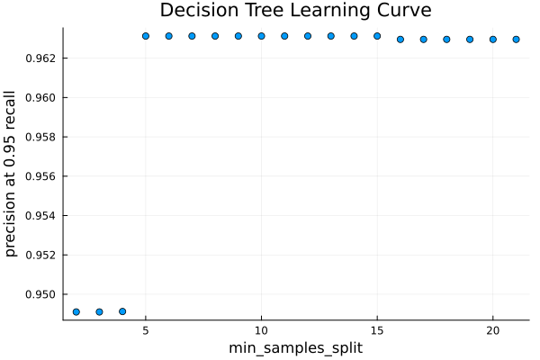
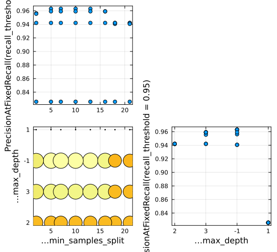

```@meta
EditURL = "notebook.jl"
```

# An Introduction to Machine Learning in Quantitative Medicine using Julia

> Anthony D. Blaom, May 2026

This tutorial presents a detailed, end-to-end application of machine learning to the
problem of creating an automated test for the presence of some disease. Specifically, we
compare several tests for hypothyroidism based on machine learning models, trained using
the well studied Garavan Institute dataset [@Quinlan_86].

The principal software tool will be the [MLJ.jl](https://juliaml.ai) machine learning
toolbox, written for the Julia programming language (Blaom et al.,
[2020](https://joss.theoj.org/papers/10.21105/joss.02704)).

[Julia](https://julialang.org) is a newer programming language with the high peformance
of older languages like FORTRAN and C, but it looks and feels like a scripting language,
such as MATLAB or Python. Julia empowers scientific domain experts, without particular
programming expertise, to rapidly prototype cutting edge solutions to their computing
needs. In Pharmacometrics modeling, for example, Pumas software [@pumas], written in
Julia, is considered best-in-class [@testament].

For resources on
learning Julia, installing Julia packages, etc, the reader is referred to the [Julia
website](https://julialang.org).

We assume readers are familiar with basic statistics, including the use of
cross-validation to guard against overfitting. Readers new to Julia will benefit
significantly from previous exposure to a scripting language, such as R, Python or
MATLAB.

## Overview

### Class imbalance and measures of test performance

In medical binary classification tasks, such as disease screening and toxicity
detection, the training data is typically unbalanced, with many more negative outcomes
than positive ones. Additionally, naive measures of task success, such as the
proportion of correct predictions, are inappropriate; we should turn to more
nuanced metrics.

Most crucially, among subjects with hypothyroidism, we seek to reduce the number for
which our test fails to return a positive result. Equivalently, we want a high
[recall](https://en.wikipedia.org/wiki/Precision_and_recall). On the other hand, we must
also account for the tendency that higher recall means more false alarms, or a lower
[precision](https://en.wikipedia.org/wiki/Precision_and_recall), where we have
proportionally more positive tests results for which a follow up investigation is
required, despite the subject not having the disease.

The approach we take here is to fix a target recall, say 0.95, and seek the test that
will maximize the corresponding precision. Other metrics commonly used for imbalanced
data will be reported alongside this main one, the **precision at 0.95 recall.**

**Going deeper.** Recall that the precision and recall of a model predicting positive or
negative outcomes can be expressed by the formulae,

$$\mathrm{recall} = 1 - \frac{\mathrm{false~negatives}}{\mathrm{positives}},\quad\mathrm{precision}=\frac{1}{1+(\mathrm{false~positives})/(\mathrm{true~negatives})}.$$

These metrics always lie between 0 and 1, and the higher, the better. ♣

### Performance of the best model

In this tutorial, we estimate the 95% confidence interval (CI) for the expected
precision at 0.95 recall of assorted machine learning models, using 70% of the Garavan
Institute dataset to do so. Promising models are then evaluated on the remaining 30%
holdout test set. For our most promising model, a probability-predicting [support vector
machine](https://en.wikipedia.org/wiki/Support_vector_machine), the CI is 0.842 ±
0.064. This estimated CI is approximate. Generally, it is difficult to obtain good
uncertainty estimates in machine learning.

As we detail later, using a probability threshold determined from the training data
delivers a model which, on the 30% holdout set, has a **recall of 98%** and **precision
of 92%**. We can also see, from the following empirical precision-recall curve, that we
may be able to increase the recall further, without dropping the precision dramatically.


> Precision-recall curve for a hypothyroidism test based on a support vector machine

### The model building workflow

The Garavan Institute dataset is actually several datasets, with varying amounts of
preprocessing. We work directly with the full "allhypo" dataset, which is unprocessed
and includes missing values and likely outliers. By **features** (a.k.a. covariates or
inputs) we will mean potential predictors of disease, like gender or blood test
results, that are recorded in the training dataset, and available for applying our test
to new subjects. The core algorithm that learns how to distinguish between "positive"
and "negative" test outcomes is known as a **supervised learner**. Examples you may have
encountered before are logistic regression and decision trees. However, for a complete
solution, we must wrap our learner in several other workflows to be detailed in this
tutorial:

- **missing value imputation**

- **outlier detection** and removal

- **coercion** of feature data types, to ensure correct "scientific" interpretation by
  MLJ models

- **one-hot encoding**, which transforms categorical features (such
  as the source of a referall) to continuous ones (needed in training many models)

- training of supervised models that report feature importances, with a view to applying
  **recursive feature elimination**, which can improve outcomes for other supervised
  models

- constructing model **pipelines**, which combine data pre-processing with a supervised
  learner, to streamline workflows and mitigate **data leakage**

- constructing approximate confidence intervals expected for the **predictive
  performance** of model pipelines

- **tuning** (optimization) of user-defined hyperparameters to further boost performance

- **oversampling** training data to correct for class imbalance

- **comparison** of several supervised learning models (**model selection**)

- plotting **precision-recall curves** for additional insight

- **thresholding:** transforming a probabilistic predictor into a predictor of
  point "positive"/"negative" outcomes, by determining an appropriate threshold for the
  "positive" class probability.

- **testing** the final model on a holdout test set

## 1. Julia setup

> Launching Julia and activating an appropriate set of third-party packages.

We suppose the user is interacting with Julia using the commandline interface known as
the **REPL**. This is typically launched by running the `julia` command from a terminal
(console) window, which delivers a `julia>` prompt, after which you can enter all the
commands in this tutorial.  Before doing so, **ensure version 1.12** or higher is used
by running `juliaup default 1.12` or similar from the terminal.

Check the Julia version by entering `versioninfo()` at the `julia>` prompt. Quit the
REPL by entering `exit()` or Ctrl-D.

You can also interact with Julia using a interactive development environment such as
VSCode or emacs, or using notebook-style interfaces such as Juptyer (python-driven),
Pluto, or Nee. We do not discuss these here, except to say that Pluto's "reactive"
feature is not well-suited to machine learning applications with long training times.

### Package management

A **package environment** is a set of specific third party packages known to be
compatible with eachother and the version of Julia you are using. Typically, each
project you work on will have it's own environment, which you will want to share with
coworkers to ensure workflow reproducibility. Although you can start to learn Julia
without worrying too much about [package management](https://pkgdocs.julialang.org/v1/),
it is worth investing time understanding this powerful Julia feature before carrying
out serious work, including this tutorial.

To create a package environment compatible with the code in this tutorial, you can:

1. Clone the GitHub repository at [https://github.com/ablaom/ClassImbalanceTutorials.jl/tree/master](https://github.com/ablaom/ClassImbalanceTutorials.jl/tree/master).

2. In a fresh REPL session, edit the right-hand side of following definition to point to the root directory of your clone: `path_to_clone = "path/to/ClassImbalanceTutorials.jl/tree/master/"`.

3. Still in the REPL, run `using Pkg; Pkg.activate(path_to_local); Pkg.resolve(); Pkg.instantiate()`.

You should expect this last step to take some time, as all the software for the tutorial
is downloaded and pre-compiled.

If you encounter issues, you can try manually installing the packages you need in a new
environment, created with `Pkg.activate("my_env")`, based on the output printed below:

````@julia
import Pkg
Pkg.status()
````

````
Status `~/work/ClassImbalanceTutorials.jl/ClassImbalanceTutorials.jl/docs/src/notebooks/thyroid/Project.toml`
  [1520ce14] AbstractTrees v0.4.5
  [336ed68f] CSV v0.10.16
  [a93c6f00] DataFrames v1.8.2
  [7806a523] DecisionTree v0.12.4
  [f6006082] EvoTrees v0.18.7
  [c709b415] Imbalance v0.1.7
  [add582a8] MLJ v0.23.2
  [c6f25543] MLJDecisionTreeInterface v0.4.4
  [094fc8d1] MLJFlux v0.6.7
  [61c7150f] MLJLIBSVMInterface v0.2.2
  [6ee0df7b] MLJLinearModels v0.10.1
  [636a865e] NearestNeighborModels v0.2.3
  [262411bb] OutlierDetection v0.4.2
  [51249a0a] OutlierDetectionNeighbors v0.1.5
  [91a5bcdd] Plots v1.41.6
  [860ef19b] StableRNGs v1.0.4
  [2913bbd2] StatsBase v0.34.11
  [f43a241f] Downloads v1.7.0

````

For example, to add MLJ v0.23.2, do `Pkg.add("MLJ@0.23.2")`.²

### Making our workflows reproducible

As many algorithms depend on pseudo-random number generators (RNG's), and as the
behaviour of the default RNG can depend on the Julia version, we take some special steps
in the tutorial so we can generate an identical RNG, stable across Julia versions,
whenever needed.

````@julia
import StableRNGs
const SEED = 234
stable_rng() = StableRNGs.StableRNG(SEED)
````

````
stable_rng (generic function with 1 method)
````

Here's a demonstation:

````@julia
rng = stable_rng()
# generate a random number between 0 and 1:
rand(rng) # this call mutates `rng` state
````

````
0.48542906587478507
````

````@julia
rand(rng)
````

````
0.09049710430456415
````

````@julia
rng = stable_rng() # reset the rng
rand(rng)          # same result as above
````

````
0.48542906587478507
````

## 2. Models and machines

> An introduction to the principal actors in an MLJ workflow

Before considering hypothyroidism, we quickly build a predictive MLJ model using a
dataset that requires no special preprocessing, the Fisher [iris
dataset](https://en.wikipedia.org/wiki/Iris_flower_data_set). It is loaded like this:

````@julia
using MLJ # load the MLJ package
X_iris, y_iris = @load_iris
X_iris
````

````
(sepal_length = [5.1, 4.9, 4.7, 4.6, 5.0, 5.4, 4.6, 5.0, 4.4, 4.9, 5.4, 4.8, 4.8, 4.3, 5.8, 5.7, 5.4, 5.1, 5.7, 5.1, 5.4, 5.1, 4.6, 5.1, 4.8, 5.0, 5.0, 5.2, 5.2, 4.7, 4.8, 5.4, 5.2, 5.5, 4.9, 5.0, 5.5, 4.9, 4.4, 5.1, 5.0, 4.5, 4.4, 5.0, 5.1, 4.8, 5.1, 4.6, 5.3, 5.0, 7.0, 6.4, 6.9, 5.5, 6.5, 5.7, 6.3, 4.9, 6.6, 5.2, 5.0, 5.9, 6.0, 6.1, 5.6, 6.7, 5.6, 5.8, 6.2, 5.6, 5.9, 6.1, 6.3, 6.1, 6.4, 6.6, 6.8, 6.7, 6.0, 5.7, 5.5, 5.5, 5.8, 6.0, 5.4, 6.0, 6.7, 6.3, 5.6, 5.5, 5.5, 6.1, 5.8, 5.0, 5.6, 5.7, 5.7, 6.2, 5.1, 5.7, 6.3, 5.8, 7.1, 6.3, 6.5, 7.6, 4.9, 7.3, 6.7, 7.2, 6.5, 6.4, 6.8, 5.7, 5.8, 6.4, 6.5, 7.7, 7.7, 6.0, 6.9, 5.6, 7.7, 6.3, 6.7, 7.2, 6.2, 6.1, 6.4, 7.2, 7.4, 7.9, 6.4, 6.3, 6.1, 7.7, 6.3, 6.4, 6.0, 6.9, 6.7, 6.9, 5.8, 6.8, 6.7, 6.7, 6.3, 6.5, 6.2, 5.9], sepal_width = [3.5, 3.0, 3.2, 3.1, 3.6, 3.9, 3.4, 3.4, 2.9, 3.1, 3.7, 3.4, 3.0, 3.0, 4.0, 4.4, 3.9, 3.5, 3.8, 3.8, 3.4, 3.7, 3.6, 3.3, 3.4, 3.0, 3.4, 3.5, 3.4, 3.2, 3.1, 3.4, 4.1, 4.2, 3.1, 3.2, 3.5, 3.1, 3.0, 3.4, 3.5, 2.3, 3.2, 3.5, 3.8, 3.0, 3.8, 3.2, 3.7, 3.3, 3.2, 3.2, 3.1, 2.3, 2.8, 2.8, 3.3, 2.4, 2.9, 2.7, 2.0, 3.0, 2.2, 2.9, 2.9, 3.1, 3.0, 2.7, 2.2, 2.5, 3.2, 2.8, 2.5, 2.8, 2.9, 3.0, 2.8, 3.0, 2.9, 2.6, 2.4, 2.4, 2.7, 2.7, 3.0, 3.4, 3.1, 2.3, 3.0, 2.5, 2.6, 3.0, 2.6, 2.3, 2.7, 3.0, 2.9, 2.9, 2.5, 2.8, 3.3, 2.7, 3.0, 2.9, 3.0, 3.0, 2.5, 2.9, 2.5, 3.6, 3.2, 2.7, 3.0, 2.5, 2.8, 3.2, 3.0, 3.8, 2.6, 2.2, 3.2, 2.8, 2.8, 2.7, 3.3, 3.2, 2.8, 3.0, 2.8, 3.0, 2.8, 3.8, 2.8, 2.8, 2.6, 3.0, 3.4, 3.1, 3.0, 3.1, 3.1, 3.1, 2.7, 3.2, 3.3, 3.0, 2.5, 3.0, 3.4, 3.0], petal_length = [1.4, 1.4, 1.3, 1.5, 1.4, 1.7, 1.4, 1.5, 1.4, 1.5, 1.5, 1.6, 1.4, 1.1, 1.2, 1.5, 1.3, 1.4, 1.7, 1.5, 1.7, 1.5, 1.0, 1.7, 1.9, 1.6, 1.6, 1.5, 1.4, 1.6, 1.6, 1.5, 1.5, 1.4, 1.5, 1.2, 1.3, 1.5, 1.3, 1.5, 1.3, 1.3, 1.3, 1.6, 1.9, 1.4, 1.6, 1.4, 1.5, 1.4, 4.7, 4.5, 4.9, 4.0, 4.6, 4.5, 4.7, 3.3, 4.6, 3.9, 3.5, 4.2, 4.0, 4.7, 3.6, 4.4, 4.5, 4.1, 4.5, 3.9, 4.8, 4.0, 4.9, 4.7, 4.3, 4.4, 4.8, 5.0, 4.5, 3.5, 3.8, 3.7, 3.9, 5.1, 4.5, 4.5, 4.7, 4.4, 4.1, 4.0, 4.4, 4.6, 4.0, 3.3, 4.2, 4.2, 4.2, 4.3, 3.0, 4.1, 6.0, 5.1, 5.9, 5.6, 5.8, 6.6, 4.5, 6.3, 5.8, 6.1, 5.1, 5.3, 5.5, 5.0, 5.1, 5.3, 5.5, 6.7, 6.9, 5.0, 5.7, 4.9, 6.7, 4.9, 5.7, 6.0, 4.8, 4.9, 5.6, 5.8, 6.1, 6.4, 5.6, 5.1, 5.6, 6.1, 5.6, 5.5, 4.8, 5.4, 5.6, 5.1, 5.1, 5.9, 5.7, 5.2, 5.0, 5.2, 5.4, 5.1], petal_width = [0.2, 0.2, 0.2, 0.2, 0.2, 0.4, 0.3, 0.2, 0.2, 0.1, 0.2, 0.2, 0.1, 0.1, 0.2, 0.4, 0.4, 0.3, 0.3, 0.3, 0.2, 0.4, 0.2, 0.5, 0.2, 0.2, 0.4, 0.2, 0.2, 0.2, 0.2, 0.4, 0.1, 0.2, 0.1, 0.2, 0.2, 0.1, 0.2, 0.2, 0.3, 0.3, 0.2, 0.6, 0.4, 0.3, 0.2, 0.2, 0.2, 0.2, 1.4, 1.5, 1.5, 1.3, 1.5, 1.3, 1.6, 1.0, 1.3, 1.4, 1.0, 1.5, 1.0, 1.4, 1.3, 1.4, 1.5, 1.0, 1.5, 1.1, 1.8, 1.3, 1.5, 1.2, 1.3, 1.4, 1.4, 1.7, 1.5, 1.0, 1.1, 1.0, 1.2, 1.6, 1.5, 1.6, 1.5, 1.3, 1.3, 1.3, 1.2, 1.4, 1.2, 1.0, 1.3, 1.2, 1.3, 1.3, 1.1, 1.3, 2.5, 1.9, 2.1, 1.8, 2.2, 2.1, 1.7, 1.8, 1.8, 2.5, 2.0, 1.9, 2.1, 2.0, 2.4, 2.3, 1.8, 2.2, 2.3, 1.5, 2.3, 2.0, 2.0, 1.8, 2.1, 1.8, 1.8, 1.8, 2.1, 1.6, 1.9, 2.0, 2.2, 1.5, 1.4, 2.3, 2.4, 1.8, 1.8, 2.1, 2.4, 2.3, 1.9, 2.3, 2.5, 2.3, 1.9, 2.0, 2.3, 1.8])
````

Here `X_iris`, the features (specimen dimensions) is a rather basic form of Julia table,
namely a named tuple of vectors; `y_iris` is an ordinary vector representing the
**target variable**, in this case an iris species.

**Going deeper.** Previously we imported package with `import`, which meant all their
methods had to be qualified, as in `import Pkg`, followed by `Pkg.status()`. Here `using
MLJ` brings most MLJ methods directly into the namespace. So, we have `@load_iris`,
instead of `MLJ.@load_iris`. (The `@` symbol denotes a special kind of method called a
[macro](https://docs.julialang.org/en/v1/manual/metaprogramming/#man-macros); beginners
needn't bother too much with the distinction.)

Although MLJ is not too fussy about table types, we'll convert `X_iris` to a
**dataframe**, Julia's defacto standard for in-memory tabular data, which has a nicer
display and is easier to manipulate:

````@julia
import DataFrames
X_iris = DataFrames.DataFrame(X_iris)
first(X_iris, 3)  # return the first three rows of the dataframe
````

```@raw html
<div><div style = "float: left;"><span>3×4 DataFrame</span></div><div style = "clear: both;"></div></div><div class = "data-frame" style = "overflow-x: scroll;"><table class = "data-frame" style = "margin-bottom: 6px;"><thead><tr class = "columnLabelRow"><th class = "stubheadLabel" style = "font-weight: bold; text-align: right;">Row</th><th style = "text-align: left;">sepal_length</th><th style = "text-align: left;">sepal_width</th><th style = "text-align: left;">petal_length</th><th style = "text-align: left;">petal_width</th></tr><tr class = "columnLabelRow"><th class = "stubheadLabel" style = "font-weight: bold; text-align: right;"></th><th title = "Float64" style = "text-align: left;">Float64</th><th title = "Float64" style = "text-align: left;">Float64</th><th title = "Float64" style = "text-align: left;">Float64</th><th title = "Float64" style = "text-align: left;">Float64</th></tr></thead><tbody><tr class = "dataRow"><td class = "rowLabel" style = "font-weight: bold; text-align: right;">1</td><td style = "text-align: right;">5.1</td><td style = "text-align: right;">3.5</td><td style = "text-align: right;">1.4</td><td style = "text-align: right;">0.2</td></tr><tr class = "dataRow"><td class = "rowLabel" style = "font-weight: bold; text-align: right;">2</td><td style = "text-align: right;">4.9</td><td style = "text-align: right;">3.0</td><td style = "text-align: right;">1.4</td><td style = "text-align: right;">0.2</td></tr><tr class = "dataRow"><td class = "rowLabel" style = "font-weight: bold; text-align: right;">3</td><td style = "text-align: right;">4.7</td><td style = "text-align: right;">3.2</td><td style = "text-align: right;">1.3</td><td style = "text-align: right;">0.2</td></tr></tbody></table></div>
```

````@julia
first(y_iris, 3)  # or, you can do `y_iris[1:3]`
````

````
3-element CategoricalArrays.CategoricalArray{String,1,UInt32}:
 "setosa"
 "setosa"
 "setosa"
````

There are three species of iris in Fisher's dataset:

````@julia
levels(y_iris)
````

````
3-element CategoricalArrays.CategoricalArray{String,1,UInt32}:
 "setosa"
 "versicolor"
 "virginica"
````

Here's how to "instantiate" a decision tree model to predict the target based on new
iris features, after importing the code needed for that model:

````@julia
DecisionTreeClassifier = @load DecisionTreeClassifier pkg=DecisionTree # model type
model = DecisionTreeClassifier(min_samples_split=5)                    # model instance
````

````
DecisionTreeClassifier(
  max_depth = -1, 
  min_samples_leaf = 1, 
  min_samples_split = 5, 
  min_purity_increase = 0.0, 
  n_subfeatures = 0, 
  post_prune = false, 
  merge_purity_threshold = 1.0, 
  display_depth = 5, 
  feature_importance = :impurity, 
  rng = Random.TaskLocalRNG())
````

With the exception of `min_samples_split`, we have selected default values of the
**hyper-parameters** of the model, namely those parameters we need to specify before any
learning begins.  Nevermind about the meaning of these hyper-parameters for now.

**Going deeper.** To see all registered MLJ models that can be immediately applied to
our data, do `models(matching(X, Y))`. See the [Model
Search](https://juliaai.github.io/MLJ.jl/dev/model_search/) section of the MLJ
documentation for more options. ♣

The word "model", ubiquitous in statistics and machine learning, has a specific meaning
in MLJ documentation and in this tutorial. A **model** is an object encapsulating a
machine learning algorithm, such as least-squares fitting of a polynomial, a decision
tree, or logistic regression, together with the hyper-parameters (such as the degree of
the polynomial). In statistics a "model" generally includes the *learned parameters*
(such as the coefficients of the polynomial) but in MLJ these are external to the model.

Next, we bind the model together with the available data in what's
called a *machine*:

````@julia
mach = machine(model, X_iris, y_iris);
````

A machine starts life as model plus data, but it additionally stores *learned
parameters* (the tree) once it is trained on some view of the data. (To guard against
overfitting, we typically do not train on all the data!).

````@julia
train_rows = 1:2:149  # the odd rows of the dataset
fit!(mach, rows=train_rows);
````

````
[ Info: Training machine(DecisionTreeClassifier(max_depth = -1, …), …).

````

The exclamation mark `!` reminds us that `mach` is begin mutated; specifically, the
learned parameters are being added. Having trained the model, we can inspect its learned
parameters like this:

````@julia
theta = fitted_params(mach)
````

````
(tree = DecisionTree.InfoNode{Float64, UInt32}(Decision Tree
Leaves: 5
Depth:  3, nchildren=2), raw_tree = Decision Tree
Leaves: 5
Depth:  3, encoding = Dict{UInt32, CategoricalArrays.CategoricalValue{String, UInt32}}(0x00000002 => CategoricalValue(CategoricalArrays.CategoricalPool{String, UInt32}(["setosa", "versicolor", "virginica"]), 2), 0x00000003 => CategoricalValue(CategoricalArrays.CategoricalPool{String, UInt32}(["setosa", "versicolor", "virginica"]), 3), 0x00000001 => CategoricalValue(CategoricalArrays.CategoricalPool{String, UInt32}(["setosa", "versicolor", "virginica"]), 1)), features = [:sepal_length, :sepal_width, :petal_length, :petal_width])
````

Here's how we can get a detailed representation of the decision tree itself:

````@julia
keys(theta)
````

````
(:tree, :raw_tree, :encoding, :features)
````

````@julia
theta.tree
````

````
petal_width < 0.7
├─ setosa (25/25)
└─ petal_width < 1.65
   ├─ petal_length < 5.25
   │  ├─ versicolor (24/24)
   │  └─ virginica (1/1)
   └─ sepal_length < 5.95
      ├─ virginica (3/4)
      └─ virginica (21/21)

````

So, for example, if `petal_width ≥ 1.65` and `sepal_length < 5.95`, then this decision
tree model predicts virginica as the species, with probability of 3/4 = 75%.

There is also a `report` function for machines, which returns any byproducts of training
that are not fitted parameters, in this case nothing particularly noteworthy:

````@julia
rprt = report(mach)
keys(rprt)
````

````
(:classes_seen, :print_tree, :features)
````

````@julia
rprt.classes_seen
````

````
3-element CategoricalArrays.CategoricalArray{String,1,UInt32}:
 "setosa"
 "versicolor"
 "virginica"
````

You are allowed to access and mutate the `model` hyper-parameters:

````@julia
model.max_depth = 1
fit!(mach, rows=train_rows) # re-train with new hyper-parameters
fitted_params(mach).tree
````

````
petal_width < 0.7
├─ setosa (25/25)
└─ versicolor (25/50)

````

**Going deeper.** A machine stores some other information enabling [warm
restart](https://juliaai.github.io/MLJ.jl/dev/machines/#Warm-restarts) for some
iterative models, such as a random forest, or the gradient tree boosting model appearing
later in this tutorial. Similary, if you call `fit!` without changing the model or the
rows you want to change, the machine will detect this and their retraining is
skipped. In model pipelines, discussed later, `fit!` only retrain component models that
actually need retraining.

Here is how we can make predictions on some other view of the bound data:

````@julia
predict(mach, rows=[2, 52, 102])
````

````
3-element CategoricalDistributions.UnivariateFiniteVector{Multiclass{3}, String, UInt32, Float64}:
 UnivariateFinite{Multiclass{3}}(setosa=>1.0, versicolor=>0.0, virginica=>0.0)
 UnivariateFinite{Multiclass{3}}(setosa=>0.0, versicolor=>0.5, virginica=>0.5)
 UnivariateFinite{Multiclass{3}}(setosa=>0.0, versicolor=>0.5, virginica=>0.5)
````

We can also supply new data. The form of new data can be most kinds of Julia table, not
just a dataframe. For example, this named tuple of vectors will work:

````@julia
Xnew = (sepal_length = [5.1, 6.3],
        sepal_width = [3.0, 2.5],
        petal_length = [1.4, 4.9],
        petal_width = [0.3, 1.5])
yhat = predict(mach, Xnew)
````

````
2-element CategoricalDistributions.UnivariateFiniteVector{Multiclass{3}, String, UInt32, Float64}:
 UnivariateFinite{Multiclass{3}}(setosa=>1.0, versicolor=>0.0, virginica=>0.0)
 UnivariateFinite{Multiclass{3}}(setosa=>0.0, versicolor=>0.5, virginica=>0.5)
````

These are *probabilistic* predictions which can be manipulated using a
widely adopted interface defined in the Distributions.jl
package. For example, we can get raw probabilities like this:

````@julia
pdf.(yhat, "virginica")
````

````
2-element Vector{Float64}:
 0.0
 0.5
````

## 3. Downloading a dataset

> Grabbing a dataset from the internet and manifesting it as an in-memory table

````@julia
import Downloads
import CSV        # for parsing CSV files
````

url = "https://archive.ics.uci.edu/ml/machine-learning-databases/"*
    "thyroid-disease/allhypo.data"

````@julia
url = "https://archive.ics.uci.edu/ml/machine-learning-databases/"*
    "thyroid-disease/allhypo.data"
path = Downloads.download(url)
````

````
"/tmp/jl_5Rax5e/allhypo.data"
````

Entering these lines of code downloads the dataset to a temporary location on your
computer. (If you have trouble with the host site, try instead
`url="https://archive.ics.uci.edu/ml/machine-learning-databases/thyroid-disease/allhypo.data"`.)
The dataset file is comma-separated, but has no header. The header can be gleaned from
[https://archive.ics.uci.edu/ml/machine-learning-databases/thyroid-disea/allhypo.names,which](https://archive.ics.uci.edu/ml/machine-learning-databases/thyroid-disea/allhypo.names,which),
which has further information about the dataset. We manually provide the header as
follows:

````@julia
header = [
    "age", "sex", "on_thyroxine", "query_on_thyroxine", "on_antithyroid_medication",
    "sick", "pregnant", "thyroid_surgery", "I131_treatment", "query_hypothyroid",
    "query_hyperthyroid", "lithium", "goitre", "tumor", "hypopituitary", "psych",
    "TSH_measured", "TSH", "T3_measured", "T3", "TT4_measured", "TT4",
    "T4U_measured", "T4U", "FTI_measured", "FTI", "TBG_measured", "TBG",
    "referral_source", "diagnosis",
]
data = CSV.read(path, DataFrames.DataFrame; header, missingstring="?");
````

This last line reads the data into a dataframe. Here's a view of part of this table:

````@julia
data[15:21, [:age, :sex, :TSH, :diagnosis]]
````

```@raw html
<div><div style = "float: left;"><span>7×4 DataFrame</span></div><div style = "clear: both;"></div></div><div class = "data-frame" style = "overflow-x: scroll;"><table class = "data-frame" style = "margin-bottom: 6px;"><thead><tr class = "columnLabelRow"><th class = "stubheadLabel" style = "font-weight: bold; text-align: right;">Row</th><th style = "text-align: left;">age</th><th style = "text-align: left;">sex</th><th style = "text-align: left;">TSH</th><th style = "text-align: left;">diagnosis</th></tr><tr class = "columnLabelRow"><th class = "stubheadLabel" style = "font-weight: bold; text-align: right;"></th><th title = "Union{Missing, Int64}" style = "text-align: left;">Int64?</th><th title = "Union{Missing, InlineStrings.String1}" style = "text-align: left;">String1?</th><th title = "Union{Missing, Float64}" style = "text-align: left;">Float64?</th><th title = "InlineStrings.String31" style = "text-align: left;">String31</th></tr></thead><tbody><tr class = "dataRow"><td class = "rowLabel" style = "font-weight: bold; text-align: right;">1</td><td style = "text-align: right;">28</td><td style = "text-align: left;">M</td><td style = "text-align: right;">3.3</td><td style = "text-align: left;">negative.|2043</td></tr><tr class = "dataRow"><td class = "rowLabel" style = "font-weight: bold; text-align: right;">2</td><td style = "text-align: right;">65</td><td style = "text-align: left;">F</td><td style = "text-align: right;">12.0</td><td style = "text-align: left;">compensated hypothyroid.|3169</td></tr><tr class = "dataRow"><td class = "rowLabel" style = "font-weight: bold; text-align: right;">3</td><td style = "text-align: right;">42</td><td style = "font-style: italic; text-align: left;">missing</td><td style = "text-align: right;">1.2</td><td style = "text-align: left;">negative.|2755</td></tr><tr class = "dataRow"><td class = "rowLabel" style = "font-weight: bold; text-align: right;">4</td><td style = "text-align: right;">63</td><td style = "text-align: left;">F</td><td style = "text-align: right;">1.5</td><td style = "text-align: left;">negative.|1010</td></tr><tr class = "dataRow"><td class = "rowLabel" style = "font-weight: bold; text-align: right;">5</td><td style = "text-align: right;">80</td><td style = "text-align: left;">F</td><td style = "text-align: right;">6.0</td><td style = "text-align: left;">negative.|803</td></tr><tr class = "dataRow"><td class = "rowLabel" style = "font-weight: bold; text-align: right;">6</td><td style = "text-align: right;">28</td><td style = "text-align: left;">M</td><td style = "text-align: right;">2.1</td><td style = "text-align: left;">negative.|2297</td></tr><tr class = "dataRow"><td class = "rowLabel" style = "font-weight: bold; text-align: right;">7</td><td style = "text-align: right;">51</td><td style = "text-align: left;">F</td><td style = "text-align: right;">0.1</td><td style = "text-align: left;">negative.|3564</td></tr></tbody></table></div>
```

There is a problem with the `diagnosis` column, which can be inspected like this:

````@julia
data.diagnosis[15:19] # rows 15 through 19
````

````
5-element Vector{InlineStrings.String31}:
 "negative.|2043"
 "compensated hypothyroid.|3169"
 "negative.|2755"
 "negative.|1010"
 "negative.|803"
````

Each entry has a trailing string which corresponds to a patient identifier we won't
need. We introduce a function to to trim such an entry, and at the same time collapse
all hypothyroidism variants into a single `"positive"` class:

````@julia
function fix(class)
    trimmed = first(split(class, ".|"))
    if trimmed == "negative"
        return trimmed
    end
    return "positive"
end
fix("compensated hypothyroid.|3169") # demo
````

````
"positive"
````

Applying it to every entry in the `diagnosis` column:

````@julia
data.diagnosis = fix.(data.diagnosis);
data.diagnosis[15:19]
````

````
5-element Vector{AbstractString}:
 "negative"
 "positive"
 "negative"
 "negative"
 "negative"
````

Here's a summary of the fields in our dataframe:

````@julia
DataFrames.describe(data)
````

```@raw html
<div><div style = "float: left;"><span>30×7 DataFrame</span></div><div style = "clear: both;"></div></div><div class = "data-frame" style = "overflow-x: scroll;"><table class = "data-frame" style = "margin-bottom: 6px;"><thead><tr class = "columnLabelRow"><th class = "stubheadLabel" style = "font-weight: bold; text-align: right;">Row</th><th style = "text-align: left;">variable</th><th style = "text-align: left;">mean</th><th style = "text-align: left;">min</th><th style = "text-align: left;">median</th><th style = "text-align: left;">max</th><th style = "text-align: left;">nmissing</th><th style = "text-align: left;">eltype</th></tr><tr class = "columnLabelRow"><th class = "stubheadLabel" style = "font-weight: bold; text-align: right;"></th><th title = "Symbol" style = "text-align: left;">Symbol</th><th title = "Union{Nothing, Float64}" style = "text-align: left;">Union…</th><th title = "Any" style = "text-align: left;">Any</th><th title = "Union{Nothing, Float64}" style = "text-align: left;">Union…</th><th title = "Any" style = "text-align: left;">Any</th><th title = "Int64" style = "text-align: left;">Int64</th><th title = "Type" style = "text-align: left;">Type</th></tr></thead><tbody><tr class = "dataRow"><td class = "rowLabel" style = "font-weight: bold; text-align: right;">1</td><td style = "text-align: left;">age</td><td style = "text-align: left;">51.8442</td><td style = "text-align: left;">1</td><td style = "text-align: left;">54.0</td><td style = "text-align: left;">455</td><td style = "text-align: right;">1</td><td style = "text-align: left;">Union{Missing, Int64}</td></tr><tr class = "dataRow"><td class = "rowLabel" style = "font-weight: bold; text-align: right;">2</td><td style = "text-align: left;">sex</td><td style = "font-style: italic; text-align: left;"></td><td style = "text-align: left;">F</td><td style = "font-style: italic; text-align: left;"></td><td style = "text-align: left;">M</td><td style = "text-align: right;">110</td><td style = "text-align: left;">Union{Missing, String1}</td></tr><tr class = "dataRow"><td class = "rowLabel" style = "font-weight: bold; text-align: right;">3</td><td style = "text-align: left;">on_thyroxine</td><td style = "font-style: italic; text-align: left;"></td><td style = "text-align: left;">f</td><td style = "font-style: italic; text-align: left;"></td><td style = "text-align: left;">t</td><td style = "text-align: right;">0</td><td style = "text-align: left;">String1</td></tr><tr class = "dataRow"><td class = "rowLabel" style = "font-weight: bold; text-align: right;">4</td><td style = "text-align: left;">query_on_thyroxine</td><td style = "font-style: italic; text-align: left;"></td><td style = "text-align: left;">f</td><td style = "font-style: italic; text-align: left;"></td><td style = "text-align: left;">t</td><td style = "text-align: right;">0</td><td style = "text-align: left;">String1</td></tr><tr class = "dataRow"><td class = "rowLabel" style = "font-weight: bold; text-align: right;">5</td><td style = "text-align: left;">on_antithyroid_medication</td><td style = "font-style: italic; text-align: left;"></td><td style = "text-align: left;">f</td><td style = "font-style: italic; text-align: left;"></td><td style = "text-align: left;">t</td><td style = "text-align: right;">0</td><td style = "text-align: left;">String1</td></tr><tr class = "dataRow"><td class = "rowLabel" style = "font-weight: bold; text-align: right;">6</td><td style = "text-align: left;">sick</td><td style = "font-style: italic; text-align: left;"></td><td style = "text-align: left;">f</td><td style = "font-style: italic; text-align: left;"></td><td style = "text-align: left;">t</td><td style = "text-align: right;">0</td><td style = "text-align: left;">String1</td></tr><tr class = "dataRow"><td class = "rowLabel" style = "font-weight: bold; text-align: right;">7</td><td style = "text-align: left;">pregnant</td><td style = "font-style: italic; text-align: left;"></td><td style = "text-align: left;">f</td><td style = "font-style: italic; text-align: left;"></td><td style = "text-align: left;">t</td><td style = "text-align: right;">0</td><td style = "text-align: left;">String1</td></tr><tr class = "dataRow"><td class = "rowLabel" style = "font-weight: bold; text-align: right;">8</td><td style = "text-align: left;">thyroid_surgery</td><td style = "font-style: italic; text-align: left;"></td><td style = "text-align: left;">f</td><td style = "font-style: italic; text-align: left;"></td><td style = "text-align: left;">t</td><td style = "text-align: right;">0</td><td style = "text-align: left;">String1</td></tr><tr class = "dataRow"><td class = "rowLabel" style = "font-weight: bold; text-align: right;">9</td><td style = "text-align: left;">I131_treatment</td><td style = "font-style: italic; text-align: left;"></td><td style = "text-align: left;">f</td><td style = "font-style: italic; text-align: left;"></td><td style = "text-align: left;">t</td><td style = "text-align: right;">0</td><td style = "text-align: left;">String1</td></tr><tr class = "dataRow"><td class = "rowLabel" style = "font-weight: bold; text-align: right;">10</td><td style = "text-align: left;">query_hypothyroid</td><td style = "font-style: italic; text-align: left;"></td><td style = "text-align: left;">f</td><td style = "font-style: italic; text-align: left;"></td><td style = "text-align: left;">t</td><td style = "text-align: right;">0</td><td style = "text-align: left;">String1</td></tr><tr class = "dataRow"><td class = "rowLabel" style = "font-weight: bold; text-align: right;">11</td><td style = "text-align: left;">query_hyperthyroid</td><td style = "font-style: italic; text-align: left;"></td><td style = "text-align: left;">f</td><td style = "font-style: italic; text-align: left;"></td><td style = "text-align: left;">t</td><td style = "text-align: right;">0</td><td style = "text-align: left;">String1</td></tr><tr class = "dataRow"><td class = "rowLabel" style = "font-weight: bold; text-align: right;">12</td><td style = "text-align: left;">lithium</td><td style = "font-style: italic; text-align: left;"></td><td style = "text-align: left;">f</td><td style = "font-style: italic; text-align: left;"></td><td style = "text-align: left;">t</td><td style = "text-align: right;">0</td><td style = "text-align: left;">String1</td></tr><tr class = "dataRow"><td class = "rowLabel" style = "font-weight: bold; text-align: right;">13</td><td style = "text-align: left;">goitre</td><td style = "font-style: italic; text-align: left;"></td><td style = "text-align: left;">f</td><td style = "font-style: italic; text-align: left;"></td><td style = "text-align: left;">t</td><td style = "text-align: right;">0</td><td style = "text-align: left;">String1</td></tr><tr class = "dataRow"><td class = "rowLabel" style = "font-weight: bold; text-align: right;">14</td><td style = "text-align: left;">tumor</td><td style = "font-style: italic; text-align: left;"></td><td style = "text-align: left;">f</td><td style = "font-style: italic; text-align: left;"></td><td style = "text-align: left;">t</td><td style = "text-align: right;">0</td><td style = "text-align: left;">String1</td></tr><tr class = "dataRow"><td class = "rowLabel" style = "font-weight: bold; text-align: right;">15</td><td style = "text-align: left;">hypopituitary</td><td style = "font-style: italic; text-align: left;"></td><td style = "text-align: left;">f</td><td style = "font-style: italic; text-align: left;"></td><td style = "text-align: left;">t</td><td style = "text-align: right;">0</td><td style = "text-align: left;">String1</td></tr><tr class = "dataRow"><td class = "rowLabel" style = "font-weight: bold; text-align: right;">16</td><td style = "text-align: left;">psych</td><td style = "font-style: italic; text-align: left;"></td><td style = "text-align: left;">f</td><td style = "font-style: italic; text-align: left;"></td><td style = "text-align: left;">t</td><td style = "text-align: right;">0</td><td style = "text-align: left;">String1</td></tr><tr class = "dataRow"><td class = "rowLabel" style = "font-weight: bold; text-align: right;">17</td><td style = "text-align: left;">TSH_measured</td><td style = "font-style: italic; text-align: left;"></td><td style = "text-align: left;">f</td><td style = "font-style: italic; text-align: left;"></td><td style = "text-align: left;">t</td><td style = "text-align: right;">0</td><td style = "text-align: left;">String1</td></tr><tr class = "dataRow"><td class = "rowLabel" style = "font-weight: bold; text-align: right;">18</td><td style = "text-align: left;">TSH</td><td style = "text-align: left;">4.67215</td><td style = "text-align: left;">0.005</td><td style = "text-align: left;">1.4</td><td style = "text-align: left;">478.0</td><td style = "text-align: right;">284</td><td style = "text-align: left;">Union{Missing, Float64}</td></tr><tr class = "dataRow"><td class = "rowLabel" style = "font-weight: bold; text-align: right;">19</td><td style = "text-align: left;">T3_measured</td><td style = "font-style: italic; text-align: left;"></td><td style = "text-align: left;">f</td><td style = "font-style: italic; text-align: left;"></td><td style = "text-align: left;">t</td><td style = "text-align: right;">0</td><td style = "text-align: left;">String1</td></tr><tr class = "dataRow"><td class = "rowLabel" style = "font-weight: bold; text-align: right;">20</td><td style = "text-align: left;">T3</td><td style = "text-align: left;">2.02497</td><td style = "text-align: left;">0.05</td><td style = "text-align: left;">2.0</td><td style = "text-align: left;">10.6</td><td style = "text-align: right;">585</td><td style = "text-align: left;">Union{Missing, Float64}</td></tr><tr class = "dataRow"><td class = "rowLabel" style = "font-weight: bold; text-align: right;">21</td><td style = "text-align: left;">TT4_measured</td><td style = "font-style: italic; text-align: left;"></td><td style = "text-align: left;">f</td><td style = "font-style: italic; text-align: left;"></td><td style = "text-align: left;">t</td><td style = "text-align: right;">0</td><td style = "text-align: left;">String1</td></tr><tr class = "dataRow"><td class = "rowLabel" style = "font-weight: bold; text-align: right;">22</td><td style = "text-align: left;">TT4</td><td style = "text-align: left;">109.072</td><td style = "text-align: left;">2.0</td><td style = "text-align: left;">104.0</td><td style = "text-align: left;">430.0</td><td style = "text-align: right;">184</td><td style = "text-align: left;">Union{Missing, Float64}</td></tr><tr class = "dataRow"><td class = "rowLabel" style = "font-weight: bold; text-align: right;">23</td><td style = "text-align: left;">T4U_measured</td><td style = "font-style: italic; text-align: left;"></td><td style = "text-align: left;">f</td><td style = "font-style: italic; text-align: left;"></td><td style = "text-align: left;">t</td><td style = "text-align: right;">0</td><td style = "text-align: left;">String1</td></tr><tr class = "dataRow"><td class = "rowLabel" style = "font-weight: bold; text-align: right;">24</td><td style = "text-align: left;">T4U</td><td style = "text-align: left;">0.997912</td><td style = "text-align: left;">0.31</td><td style = "text-align: left;">0.98</td><td style = "text-align: left;">2.12</td><td style = "text-align: right;">297</td><td style = "text-align: left;">Union{Missing, Float64}</td></tr><tr class = "dataRow"><td class = "rowLabel" style = "font-weight: bold; text-align: right;">25</td><td style = "text-align: left;">FTI_measured</td><td style = "font-style: italic; text-align: left;"></td><td style = "text-align: left;">f</td><td style = "font-style: italic; text-align: left;"></td><td style = "text-align: left;">t</td><td style = "text-align: right;">0</td><td style = "text-align: left;">String1</td></tr><tr class = "dataRow"><td class = "rowLabel" style = "font-weight: bold; text-align: right;">26</td><td style = "text-align: left;">FTI</td><td style = "text-align: left;">110.788</td><td style = "text-align: left;">2.0</td><td style = "text-align: left;">107.0</td><td style = "text-align: left;">395.0</td><td style = "text-align: right;">295</td><td style = "text-align: left;">Union{Missing, Float64}</td></tr><tr class = "dataRow"><td class = "rowLabel" style = "font-weight: bold; text-align: right;">27</td><td style = "text-align: left;">TBG_measured</td><td style = "font-style: italic; text-align: left;"></td><td style = "text-align: left;">f</td><td style = "font-style: italic; text-align: left;"></td><td style = "text-align: left;">f</td><td style = "text-align: right;">0</td><td style = "text-align: left;">String1</td></tr><tr class = "dataRow"><td class = "rowLabel" style = "font-weight: bold; text-align: right;">28</td><td style = "text-align: left;">TBG</td><td style = "font-style: italic; text-align: left;"></td><td style = "font-style: italic; text-align: left;"></td><td style = "font-style: italic; text-align: left;"></td><td style = "font-style: italic; text-align: left;"></td><td style = "text-align: right;">2800</td><td style = "text-align: left;">Missing</td></tr><tr class = "dataRow"><td class = "rowLabel" style = "font-weight: bold; text-align: right;">29</td><td style = "text-align: left;">referral_source</td><td style = "font-style: italic; text-align: left;"></td><td style = "text-align: left;">STMW</td><td style = "font-style: italic; text-align: left;"></td><td style = "text-align: left;">other</td><td style = "text-align: right;">0</td><td style = "text-align: left;">String7</td></tr><tr class = "dataRow"><td class = "rowLabel" style = "font-weight: bold; text-align: right;">30</td><td style = "text-align: left;">diagnosis</td><td style = "font-style: italic; text-align: left;"></td><td style = "text-align: left;">negative</td><td style = "font-style: italic; text-align: left;"></td><td style = "text-align: left;">positive</td><td style = "text-align: right;">0</td><td style = "text-align: left;">AbstractString</td></tr></tbody></table></div>
```

Two of the fields are constant for all observations, and a third is constant outside of
a single observation. As these provide no useful information, we drop them:

````@julia
DataFrames.select!(data, DataFrames.Not([:TBG_measured, :TBG, :hypopituitary]));
````

The exclamation mark `!` in `select!` indicates that the function is mutating it's
argument, `data`, in-place.

Incidentally, to view the documentation for the `DataFrames.describe` function, you can
enter `?DataFrames.describe` in the REPL.

**Going deeper.** The DataFrames.jl features we have demonstrated so far will suffice
for the remainder of this tutorial. For more on manipulating dataframes, see the
[DataFrames.jl documentation](https://dataframes.juliadata.org/stable/). DataFrames.jl
is an essential tool in so-called exploratory data analysis (EDA), not covered here;
see, e.g., Storopoli et
al. [(2021)](https://juliadatascience.github.io/JuliaDataScience/). ♣

Here's how you can save the tidied-up data as a CSV file, including header, in your
current directory:

```julia
CSV.write("allhypo.csv", data)
```

Load it again with `data = CSV.read("allhypo.csv", DataFrames.DataFrame)`.

## 4. Type coercion

> Encoding data so that it is correctly interpreted by MLJ algorithms

A physical variable, such as height, can be represented in different ways on a
computer. For example, a person's height in centimeters, although a "continuous"
variable, might be represented as a 64-bit integer. On the other hand, an unordered
factor ("multiclass") variable, like ethnicity, might also have an integer
encoding. This can lead to ambiguity, from the point of view of machine learning
algorithms that may treat integer data differently from, say, float data.

For the above reason, MLJ makes a formal distinction between the *machine*
representation of data, and the *scientific* interpretation of that data, as laid out by
certain conventions shared by all MLJ algorithms. By design, MLJ allows users to focus
more on scientific types, and view machine types as a secondary "implementation detail".

To find out what how your data will be interpreted, we use `scitype`. To correct for a
undesirable interpretation, we use `coerce`:

````@julia
scitype(183)
````

````
Count
````

`Count` corresponds to discrete, ordered data of an unbounded nature, such as the number
telephone calls received per hour, or the number of residents in a dwelling.

````@julia
height = [183, 201, 162, 108]
scitype(height)
````

````
AbstractVector{Count} (alias for AbstractArray{Count, 1})
````

````@julia
height = coerce(height, Continuous)
````

````
4-element Vector{Float64}:
 183.0
 201.0
 162.0
 108.0
````

````@julia
scitype(height)
````

````
AbstractVector{Continuous} (alias for AbstractArray{Continuous, 1})
````

Here's another example:

````@julia
blood_type = ["A", "B", "A", "AB", "O", "B"]
scitype(blood_type)
````

````
AbstractVector{Textual} (alias for AbstractArray{Textual, 1})
````

````@julia
blood_type = coerce(blood_type, Multiclass)
scitype(blood_type)
````

````
AbstractVector{Multiclass{4}} (alias for AbstractArray{Multiclass{4}, 1})
````

Note here that the number of factors (4) appears as a type parameter.

`Textual` is a scitype reserved for data with actual semantic meaning, in the sense of
some natural language; this comes up in sentiment analysis (e.g., spam email detection)
but rarely in quantitative medicine. The principal "scalar" scientific types (called
**scitypes**) are summarized in the graphic below.


For an explanation of `Finite` and `Infinite` see the next "Going deeper" section
below. While a table also has a scitype, it is more convenient to inspect the column
scitypes with `schema`:

````@julia
schema(data)
````

````
┌───────────────────────────┬────────────────────────────┬──────────────────────
│ names                     │ scitypes                   │ types               ⋯
├───────────────────────────┼────────────────────────────┼──────────────────────
│ age                       │ Union{Missing, Count}      │ Union{Missing, Int6 ⋯
│ sex                       │ Union{Missing, Textual}    │ Union{Missing, Stri ⋯
│ on_thyroxine              │ Textual                    │ String1             ⋯
│ query_on_thyroxine        │ Textual                    │ String1             ⋯
│ on_antithyroid_medication │ Textual                    │ String1             ⋯
│ sick                      │ Textual                    │ String1             ⋯
│ pregnant                  │ Textual                    │ String1             ⋯
│ thyroid_surgery           │ Textual                    │ String1             ⋯
│ I131_treatment            │ Textual                    │ String1             ⋯
│ query_hypothyroid         │ Textual                    │ String1             ⋯
│ query_hyperthyroid        │ Textual                    │ String1             ⋯
│ lithium                   │ Textual                    │ String1             ⋯
│ goitre                    │ Textual                    │ String1             ⋯
│ tumor                     │ Textual                    │ String1             ⋯
│ psych                     │ Textual                    │ String1             ⋯
│ TSH_measured              │ Textual                    │ String1             ⋯
│ TSH                       │ Union{Missing, Continuous} │ Union{Missing, Floa ⋯
│ T3_measured               │ Textual                    │ String1             ⋯
│ T3                        │ Union{Missing, Continuous} │ Union{Missing, Floa ⋯
│ TT4_measured              │ Textual                    │ String1             ⋯
│ TT4                       │ Union{Missing, Continuous} │ Union{Missing, Floa ⋯
│ T4U_measured              │ Textual                    │ String1             ⋯
│ T4U                       │ Union{Missing, Continuous} │ Union{Missing, Floa ⋯
│ FTI_measured              │ Textual                    │ String1             ⋯
│ FTI                       │ Union{Missing, Continuous} │ Union{Missing, Floa ⋯
│ referral_source           │ Textual                    │ String7             ⋯
│ diagnosis                 │ Textual                    │ AbstractString      ⋯
└───────────────────────────┴────────────────────────────┴──────────────────────
                                                                1 column omitted

````

Based on what we understand about the real world meaning each column, we can fix
some specific column scitypes like this:

````@julia
data = coerce(
    data,
    :age=> Continuous,
    :sex => Multiclass,
    :referral_source => Multiclass,
);
````

````
┌ Info: Trying to coerce from `Union{Missing, Int64}` to `Continuous`.
└ Coerced to `Union{Missing,Continuous}` instead.
┌ Info: Trying to coerce from `Union{Missing, InlineStrings.String1}` to `Multiclass`.
└ Coerced to `Union{Missing,Multiclass}` instead.

````

And we can simultaneously ensure all `Textual` scitypes are re-encoded as
`OrderedFactor`:

````@julia
data = coerce(data, Textual => OrderedFactor);
schema(data)
````

````
┌───────────────────────────┬───────────────────────────────┬───────────────────
│ names                     │ scitypes                      │ types            ⋯
├───────────────────────────┼───────────────────────────────┼───────────────────
│ age                       │ Union{Missing, Continuous}    │ Union{Missing, F ⋯
│ sex                       │ Union{Missing, Multiclass{2}} │ Union{Missing, C ⋯
│ on_thyroxine              │ OrderedFactor{2}              │ CategoricalValue ⋯
│ query_on_thyroxine        │ OrderedFactor{2}              │ CategoricalValue ⋯
│ on_antithyroid_medication │ OrderedFactor{2}              │ CategoricalValue ⋯
│ sick                      │ OrderedFactor{2}              │ CategoricalValue ⋯
│ pregnant                  │ OrderedFactor{2}              │ CategoricalValue ⋯
│ thyroid_surgery           │ OrderedFactor{2}              │ CategoricalValue ⋯
│ I131_treatment            │ OrderedFactor{2}              │ CategoricalValue ⋯
│ query_hypothyroid         │ OrderedFactor{2}              │ CategoricalValue ⋯
│ query_hyperthyroid        │ OrderedFactor{2}              │ CategoricalValue ⋯
│ lithium                   │ OrderedFactor{2}              │ CategoricalValue ⋯
│ goitre                    │ OrderedFactor{2}              │ CategoricalValue ⋯
│ tumor                     │ OrderedFactor{2}              │ CategoricalValue ⋯
│ psych                     │ OrderedFactor{2}              │ CategoricalValue ⋯
│ TSH_measured              │ OrderedFactor{2}              │ CategoricalValue ⋯
│ TSH                       │ Union{Missing, Continuous}    │ Union{Missing, F ⋯
│ T3_measured               │ OrderedFactor{2}              │ CategoricalValue ⋯
│ T3                        │ Union{Missing, Continuous}    │ Union{Missing, F ⋯
│ TT4_measured              │ OrderedFactor{2}              │ CategoricalValue ⋯
│ TT4                       │ Union{Missing, Continuous}    │ Union{Missing, F ⋯
│ T4U_measured              │ OrderedFactor{2}              │ CategoricalValue ⋯
│ T4U                       │ Union{Missing, Continuous}    │ Union{Missing, F ⋯
│ FTI_measured              │ OrderedFactor{2}              │ CategoricalValue ⋯
│ FTI                       │ Union{Missing, Continuous}    │ Union{Missing, F ⋯
│ referral_source           │ Multiclass{5}                 │ CategoricalValue ⋯
│ diagnosis                 │ OrderedFactor{2}              │ CategoricalValue ⋯
└───────────────────────────┴───────────────────────────────┴───────────────────
                                                                1 column omitted

````

There is no separate binary scitype in Julia, only `Finite{2}` and `Multiclass{2}`. We
use the latter for data with a natural choice of "positive" class, as we have for the
`diagnosis` field, and use `Multiclass{2}` otherwise, as we have for `sex`.

**Going deeper.** For more on scientific types see the [ScientificTypes.jl
documentation](https://juliaai.github.io/ScientificTypes.jl/dev/). See also the MLJ
manual entry, [Working with Categorical
Data](https://juliaai.github.io/MLJ.jl/dev/working_with_categorical_data/#Working-with-Categorical-Data). Scientific
types are formal Julia abstract types, and so they have no instances. If you know
something about Julia's type system, you will understand `Finite` and `Infinite` in the
diagram above as abstract supertypes, which get used in MLJ method
dispatch. `Multiclass` and `Ordered` factor columns are encoded as `CategoricalVector`s
from the [CategoricalArrays.jl](https://categoricalarrays.juliadata.org/stable/)
package, which means they are stored internally as integer arrays for efficiency. ♣

Here's how we can see that "negative" diagnoses are overrepresented in our data:

````@julia
import StatsBase
d = StatsBase.countmap(data.diagnosis)
````

````
Dict{CategoricalArrays.CategoricalValue{String, UInt32}, Int64} with 2 entries:
  CategoricalValue(CategoricalArrays.CategoricalPool{String, UInt32}(["negative", "positive"], true), 1) => 2580
  CategoricalValue(CategoricalArrays.CategoricalPool{String, UInt32}(["negative", "positive"], true), 2) => 220
````

Julia is being a bit too verbose with data types here. We can fix this like this:

````@julia
@info "diagnosis class counts" d["negative"] d["positive"]
````

````
┌ Info: diagnosis class counts
│   d["negative"] = 2580
└   d["positive"] = 220

````

There are about 15 times more negative outcomes as positive ones.

Before proceeding any further, we set aside 30% of our data for final testing. We
instruct MLJ's `partition` function to shuffle observations and make sure each split has
the same representation of "positive" and "negative" classes (the partition is
stratified):

````@julia
data, data_test = partition(
    data,
    0.7;
    stratify=data.diagnosis,
    rng=stable_rng(),
);

ntrain = nrows(data)
ntest = nrows(data_test)
@info "size of datasets" ntrain ntest

proportions_train = StatsBase.proportionmap(data_test.diagnosis)
proportions_test = StatsBase.proportionmap(data_test.diagnosis)
@info "diagnosis distribution" proportions_train["positive"] proportions_test["positive"]
````

````
┌ Info: size of datasets
│   ntrain = 1960
└   ntest = 840
┌ Info: diagnosis distribution
│   proportions_train["positive"] = 0.07857142857142857
└   proportions_test["positive"] = 0.07857142857142857

````

## 5. Missing value imputation

> Cleaning a dataset by finding reasonable proxies for missing values

To remove missing values, we will use an imputation algorithm called `FillImputer`.  To
search for available models related to imputation, you can run
`models("impute")`. Unlike the `DecisionTreeClassifier` we used earlier, `FillImputer`
is is immediately available (no need to `@load` it). To see all currently loaded models,
run `localmodels()`.

Enter `?FillImputer` in the REPL to pull up its document string. From there we can see
that, by default, `FillImputer`:

- replaces missing values in a `Continuous` feature with the **median**.
- replaces missing values in a `Multiclass` or `OrderedFactor` feature with the **mode**.

Lets start by seeing how we would train such a model on all the training data:

````@julia
model = FillImputer()
mach = machine(model, data);
fit!(mach);
````

````
[ Info: Training machine(FillImputer(features = Symbol[], …), …).

````

Now, as this is "transformer" rather than a supervised learner, we use `transform`
instead of `predict` to get the imputed output:

````@julia
data_clean = transform(mach, data);
````

Missing values are now gone, which you can check by doing `schema(data_clean)`.

## 6. Model pipelines and outlier removal

> Combining several machine learning workflows into a single model you can train in one
> step, and programatically removing outliers

The dangers of automated outlier removal notwithstanding (Barnett and Lewis,
[1994](https://onlinelibrary.wiley.com/doi/10.1002/bimj.4710370219)), we employ a
K-nearest neighbor algorithm for detecting outliers in our training data (Knorr et al.,
[2000](https://link.springer.com/article/10.1007/s007780050006)).

To apply this algorithm (and some later supervised learners) we need all our features to
be `Continuous`, and to have a normal range of values, i.e. to be standardized. We use
[one-hot encoding](https://en.wikipedia.org/wiki/One-hot) to transform our
`OrderedFactor` and `Multiclass` features into `Continuous` ones, and `Standardizer` to
standardize those features. Both these models are built-in.

Instead of applying each data preprocessing step separately, we can combine these steps
into a single model **pipeline** using MLJ's `|>` syntax:

````@julia
preprocess = FillImputer() |> OneHotEncoder(drop_last=true) |> Standardizer()
````

````
UnsupervisedPipeline(
  fill_imputer = FillImputer(
        features = Symbol[], 
        continuous_fill = MLJTransforms._median, 
        count_fill = MLJTransforms._round_median, 
        finite_fill = MLJTransforms._mode), 
  one_hot_encoder = OneHotEncoder(
        features = Symbol[], 
        drop_last = true, 
        ordered_factor = true, 
        ignore = false), 
  standardizer = Standardizer(
        features = Symbol[], 
        ignore = false, 
        ordered_factor = false, 
        count = false), 
  cache = true)
````

A pipepline is an example of a **composite** model, namely a model that has other models
as hyperparameters, which leads to **nested hyper-parameters**, which can be accessed
like this:

````@julia
preprocess.one_hot_encoder.drop_last
````

````
true
````

Let's apply this complete pipeline to get our sought-after continuous features:

````@julia
mach = machine(preprocess, data)
fit!(mach, verbosity=0)
data_continuous =  transform(mach, data);
first(data_continuous, 3)
````

```@raw html
<div><div style = "float: left;"><span>3×30 DataFrame</span></div><div style = "clear: both;"></div></div><div class = "data-frame" style = "overflow-x: scroll;"><table class = "data-frame" style = "margin-bottom: 6px;"><thead><tr class = "columnLabelRow"><th class = "stubheadLabel" style = "font-weight: bold; text-align: right;">Row</th><th style = "text-align: left;">age</th><th style = "text-align: left;">sex__F</th><th style = "text-align: left;">on_thyroxine__f</th><th style = "text-align: left;">query_on_thyroxine__f</th><th style = "text-align: left;">on_antithyroid_medication__f</th><th style = "text-align: left;">sick__f</th><th style = "text-align: left;">pregnant__f</th><th style = "text-align: left;">thyroid_surgery__f</th><th style = "text-align: left;">I131_treatment__f</th><th style = "text-align: left;">query_hypothyroid__f</th><th style = "text-align: left;">query_hyperthyroid__f</th><th style = "text-align: left;">lithium__f</th><th style = "text-align: left;">goitre__f</th><th style = "text-align: left;">tumor__f</th><th style = "text-align: left;">psych__f</th><th style = "text-align: left;">TSH_measured__f</th><th style = "text-align: left;">TSH</th><th style = "text-align: left;">T3_measured__f</th><th style = "text-align: left;">T3</th><th style = "text-align: left;">TT4_measured__f</th><th style = "text-align: left;">TT4</th><th style = "text-align: left;">T4U_measured__f</th><th style = "text-align: left;">T4U</th><th style = "text-align: left;">FTI_measured__f</th><th style = "text-align: left;">FTI</th><th style = "text-align: left;">referral_source__STMW</th><th style = "text-align: left;">referral_source__SVHC</th><th style = "text-align: left;">referral_source__SVHD</th><th style = "text-align: left;">referral_source__SVI</th><th style = "text-align: left;">diagnosis__negative</th></tr><tr class = "columnLabelRow"><th class = "stubheadLabel" style = "font-weight: bold; text-align: right;"></th><th title = "Float64" style = "text-align: left;">Float64</th><th title = "Float64" style = "text-align: left;">Float64</th><th title = "Float64" style = "text-align: left;">Float64</th><th title = "Float64" style = "text-align: left;">Float64</th><th title = "Float64" style = "text-align: left;">Float64</th><th title = "Float64" style = "text-align: left;">Float64</th><th title = "Float64" style = "text-align: left;">Float64</th><th title = "Float64" style = "text-align: left;">Float64</th><th title = "Float64" style = "text-align: left;">Float64</th><th title = "Float64" style = "text-align: left;">Float64</th><th title = "Float64" style = "text-align: left;">Float64</th><th title = "Float64" style = "text-align: left;">Float64</th><th title = "Float64" style = "text-align: left;">Float64</th><th title = "Float64" style = "text-align: left;">Float64</th><th title = "Float64" style = "text-align: left;">Float64</th><th title = "Float64" style = "text-align: left;">Float64</th><th title = "Float64" style = "text-align: left;">Float64</th><th title = "Float64" style = "text-align: left;">Float64</th><th title = "Float64" style = "text-align: left;">Float64</th><th title = "Float64" style = "text-align: left;">Float64</th><th title = "Float64" style = "text-align: left;">Float64</th><th title = "Float64" style = "text-align: left;">Float64</th><th title = "Float64" style = "text-align: left;">Float64</th><th title = "Float64" style = "text-align: left;">Float64</th><th title = "Float64" style = "text-align: left;">Float64</th><th title = "Float64" style = "text-align: left;">Float64</th><th title = "Float64" style = "text-align: left;">Float64</th><th title = "Float64" style = "text-align: left;">Float64</th><th title = "Float64" style = "text-align: left;">Float64</th><th title = "Float64" style = "text-align: left;">Float64</th></tr></thead><tbody><tr class = "dataRow"><td class = "rowLabel" style = "font-weight: bold; text-align: right;">1</td><td style = "text-align: right;">-1.05864</td><td style = "text-align: right;">0.662447</td><td style = "text-align: right;">0.363629</td><td style = "text-align: right;">0.120355</td><td style = "text-align: right;">0.111312</td><td style = "text-align: right;">0.199418</td><td style = "text-align: right;">0.120355</td><td style = "text-align: right;">0.111312</td><td style = "text-align: right;">0.132831</td><td style = "text-align: right;">0.240239</td><td style = "text-align: right;">0.249597</td><td style = "text-align: right;">0.0784667</td><td style = "text-align: right;">0.0906987</td><td style = "text-align: right;">0.161755</td><td style = "text-align: right;">0.224387</td><td style = "text-align: right;">-0.328505</td><td style = "text-align: right;">-0.227419</td><td style = "text-align: right;">-0.513387</td><td style = "text-align: right;">0.809805</td><td style = "text-align: right;">-0.259815</td><td style = "text-align: right;">-0.834078</td><td style = "text-align: right;">-0.338887</td><td style = "text-align: right;">-0.857</td><td style = "text-align: right;">-0.337951</td><td style = "text-align: right;">-0.477093</td><td style = "text-align: right;">-0.183679</td><td style = "text-align: right;">2.97401</td><td style = "text-align: right;">-0.10894</td><td style = "text-align: right;">-0.6173</td><td style = "text-align: right;">0.291938</td></tr><tr class = "dataRow"><td class = "rowLabel" style = "font-weight: bold; text-align: right;">2</td><td style = "text-align: right;">1.00378</td><td style = "text-align: right;">0.662447</td><td style = "text-align: right;">0.363629</td><td style = "text-align: right;">0.120355</td><td style = "text-align: right;">0.111312</td><td style = "text-align: right;">0.199418</td><td style = "text-align: right;">0.120355</td><td style = "text-align: right;">0.111312</td><td style = "text-align: right;">0.132831</td><td style = "text-align: right;">0.240239</td><td style = "text-align: right;">0.249597</td><td style = "text-align: right;">0.0784667</td><td style = "text-align: right;">0.0906987</td><td style = "text-align: right;">0.161755</td><td style = "text-align: right;">0.224387</td><td style = "text-align: right;">-0.328505</td><td style = "text-align: right;">-0.233471</td><td style = "text-align: right;">-0.513387</td><td style = "text-align: right;">-1.95238</td><td style = "text-align: right;">-0.259815</td><td style = "text-align: right;">0.152653</td><td style = "text-align: right;">-0.338887</td><td style = "text-align: right;">-0.578388</td><td style = "text-align: right;">-0.337951</td><td style = "text-align: right;">0.555189</td><td style = "text-align: right;">-0.183679</td><td style = "text-align: right;">-0.336075</td><td style = "text-align: right;">-0.10894</td><td style = "text-align: right;">1.61913</td><td style = "text-align: right;">0.291938</td></tr><tr class = "dataRow"><td class = "rowLabel" style = "font-weight: bold; text-align: right;">3</td><td style = "text-align: right;">-0.243267</td><td style = "text-align: right;">-1.50878</td><td style = "text-align: right;">0.363629</td><td style = "text-align: right;">0.120355</td><td style = "text-align: right;">0.111312</td><td style = "text-align: right;">0.199418</td><td style = "text-align: right;">0.120355</td><td style = "text-align: right;">0.111312</td><td style = "text-align: right;">0.132831</td><td style = "text-align: right;">0.240239</td><td style = "text-align: right;">0.249597</td><td style = "text-align: right;">0.0784667</td><td style = "text-align: right;">0.0906987</td><td style = "text-align: right;">0.161755</td><td style = "text-align: right;">0.224387</td><td style = "text-align: right;">-0.328505</td><td style = "text-align: right;">0.0993808</td><td style = "text-align: right;">-0.513387</td><td style = "text-align: right;">-0.156958</td><td style = "text-align: right;">-0.259815</td><td style = "text-align: right;">-0.804177</td><td style = "text-align: right;">-0.338887</td><td style = "text-align: right;">0.0345593</td><td style = "text-align: right;">-0.337951</td><td style = "text-align: right;">-0.896458</td><td style = "text-align: right;">-0.183679</td><td style = "text-align: right;">-0.336075</td><td style = "text-align: right;">-0.10894</td><td style = "text-align: right;">1.61913</td><td style = "text-align: right;">0.291938</td></tr></tbody></table></div>
```

We are ready to instantiate our K-nearest neighbor outlier detector. We additionally
need the `ProbabilisticDetector` wrapper for detectors, so that the detector's
predictions are probabilistic. This wrapper is provided by the package
OutlierDetection.jl, which we must explicitly import. Training and prediction proceeds
following a familiar pattern:

````@julia
import OutlierDetection
KNNDetector = @load KNNDetector pkg=OutlierDetectionNeighbors
detector = OutlierDetection.ProbabilisticDetector(KNNDetector())
mach = machine(detector, data_continuous)
fit!(mach)
data.detector_outcome = predict(mach, data_continuous); # add results to the dataframe
first(data.detector_outcome, 3)
````

````
3-element CategoricalDistributions.UnivariateFiniteVector{OrderedFactor{2}, String, UInt8, Float64}:
 UnivariateFinite{OrderedFactor{2}}(normal=>0.936, outlier=>0.0637)
 UnivariateFinite{OrderedFactor{2}}(normal=>0.96, outlier=>0.04)
 UnivariateFinite{OrderedFactor{2}}(normal=>0.966, outlier=>0.0343)
````

We now choose a rejection rate, which should not be too high or we will remove
informative inliers. Having experimented with different rates, we choose a rate we know
to optimize the out-of-sample performance of the supervised models to be introduced
later, about 5%. From this rate, we determine the threshold probability of normality,
and dump the corresponding outlier subjects:

````@julia
using Statistics # to get the `quantile` method
rejection_rate = 0.05 # chosen based on experimentation
threshold = quantile(pdf.(data.detector_outcome, "normal"), rejection_rate)
data = filter(data) do row
    pdf(row.detector_outcome, "normal") > threshold
end;
proportion_accepted = nrows(data)/ntrain
````

````
0.95
````

**Going deeper.** Having used it to remove outliers, we make no further use of
`data_continuous`. Later, when we perform cross validation to estimate performance of
our supervised models, we will re-apply our data preprocessing to each training and
validation fold, but using learned parameters (such as the mean and variance computed in
standardization) based only on the *training* fold. This mitigates [data
leakage](https://en.wikipedia.org/wiki/Leakage_(machine_learning)) into our validation
sets. Having combined our preprocessing algorithms into a single pipeline model makes
this rather easy to do.  ♣

## 7. Evaluating a supervised model

> Tools to efficiently compute estimates of the expected performance of a supervised
> machine learning model for prediction, and understanding how those tools work under
> the hood

We are almost ready to train our first supervised predictive model. In preparation, we
horizontally split our training data into a table of features `X`, and a vector target
`y`, the diagnosis we want to predict, given new features.

````@julia
y, X, _ = unpack(data, ==(:diagnosis), !=(:detector_outcome));
schema(X).names
````

````
(:age, :sex, :on_thyroxine, :query_on_thyroxine, :on_antithyroid_medication, :sick, :pregnant, :thyroid_surgery, :I131_treatment, :query_hypothyroid, :query_hyperthyroid, :lithium, :goitre, :tumor, :psych, :TSH_measured, :TSH, :T3_measured, :T3, :TT4_measured, :TT4, :T4U_measured, :T4U, :FTI_measured, :FTI, :referral_source)
````

Notice that we have also dropped the `detector_outcome` field, which is no longer
relevant.

**Going deeper.** To interpret this, note that `==(:diagnosis)` defines a function such
that `==(:diagnosis)(x)` is `true` if `x == :diagnosis`, and `false` otherwise. The
`unpack` command takes any column of `data` which has a name on which this function
returns `true`, and puts it into `y`. Of the remaining columns, any with name *not*
equal to `:detector_outcome` goes into `X`, while the last returned value, discarded
here, is everything remaining (in this case the `:detector_outcome` column).  By
default, a single column is always returned as a vector instead of a table. ♣

The first supervised model we will train is a [gradient tree boosting
model](https://en.wikipedia.org/wiki/Gradient_boosting). For tabular data where the
columns have distinct interpretations, this is often the best performing model. For
image data, audio or video, and for some types of natural language processing, neural
networks may be a better first choice. A gradient tree booster is relatively quick to
train, and, as a byproduct of training, it can rank the importance of our features. We
will use this to apply recursive feature elimination, discussed later.

We will use the gradient tree booster `EvoTreeClassifier` from the EvoTrees.jl package,
combining it with the same data preprocessing discussed above:

````@julia
EvoTreeClassifier = @load EvoTreeClassifier
bare_booster = EvoTreeClassifier()
booster = preprocess |> bare_booster;
````

````
[ Info: For silent loading, specify `verbosity=0`. 
import EvoTrees ✔

````

We will now estimate the expected precision at 0.95 recall in two ways: (i) by hand,
using a simle holdout set, and (ii) using stratified cross-validation and MLJ's
`evaluate` function.

### A holdout performance estimate (by hand)

For an objective estimate of performance, and without touching our reserved test set, we
split our training indices further into `core_train` and `validation` sets, in the ratio
60:40:

````@julia
core_train, validation = partition(eachindex(y), 0.6; stratify=y);
````

We train on `core_train`:

````@julia
mach = machine(booster, X, y)
fit!(mach, rows=core_train, verbosity=0);
````

And we predict on `validation`:

````@julia
yhat = predict(mach, rows=validation)
first(yhat, 3)
````

````
3-element CategoricalDistributions.UnivariateFiniteVector{OrderedFactor{2}, String, UInt32, Float32}:
 UnivariateFinite{OrderedFactor{2}}(negative=>0.00633, positive=>0.994)
 UnivariateFinite{OrderedFactor{2}}(negative=>0.00646, positive=>0.994)
 UnivariateFinite{OrderedFactor{2}}(negative=>0.0048, positive=>0.995)
````

Our metric is defined like this:

````@julia
precision_at_95 = PrecisionAtFixedRecall(0.95)
````

````
PrecisionAtFixedRecall(
  recall_threshold = 0.95)
````

And we evaluate like so:

````@julia
precision_at_95(yhat, y[validation])
````

````
0.864406779661017
````

This is an estimate of the expected precision if we choose a probability threshold for
the positive class giving us 95% recall. The mechanics of thresholding are discussed
later. Unfortunately, this single estimate does not come with any associated estimate of
uncertainty. We have no firm basis for rejecting the possibility that, by chance, our
empirical estimate is significantly larger than the true population value. Our second
approach attempts to address this issue.

### Stratified cross-validation (automated)

Recall that in [k-fold
cross-validation](https://en.wikipedia.org/wiki/Cross-validation_(statistics)) we split
a data set into train and validation sets in `k` different ways, using a partition of
the data into `k` so-called **folds**. Each fold is a training set, and the fold's
complement the corresponding validation set. We thus get `k` separate estimates of
expected performance, whose mean and variance furnish a confidence interval for the
expected peformance in the general population.

Unfortunately, as the individual fold estimates are not truly independent, this naive
approach is flawed, as is well known (Dietterich,
[1998](https://doi.org/10.1162/089976698300017197)). Some variants of the method attempt
to improve the quality of the CI (we adopt one shortly) but ultimately better estimates
rely on difficult to analyze specifics of the predictive model, and on assumptions about
the underlying data generating process. This is an active area of research.

Data scientists typically report the naive CI's, with the admonition that such estimates
are not 100% reliable.

Here's how we can quickly get a CI for the precision at 0.95 recall, using six-fold
cross-validation. Here we are using all rows of our training data `(X, y)` to construct
the folds. To restrict the data used, include a `rows=...` specification.

````@julia
evaluate(booster, X, y; resampling=StratifiedCV(nfolds=6), measure=precision_at_95, verbosity=0)
````

````
PerformanceEvaluation object with these fields:
  model, tag, measure, operation,
  measurement, uncertainty_radius_95, per_fold, per_observation,
  fitted_params_per_fold, report_per_fold,
  train_test_rows, resampling, repeats
Tag: ProbabilisticPipeline-478
Extract:
┌────────────────────────────┬───────────┬─────────────┐
│ measure                    │ operation │ measurement │
├────────────────────────────┼───────────┼─────────────┤
│ PrecisionAtFixedRecall(    │ predict   │ 0.888       │
│   recall_threshold = 0.95) │           │             │
└────────────────────────────┴───────────┴─────────────┘
┌────────────────────────────────────────────┬─────────┐
│ per_fold                                   │ 1.96*SE │
├────────────────────────────────────────────┼─────────┤
│ [0.894, 0.777, 0.914, 0.875, 0.913, 0.955] │ 0.053   │
└────────────────────────────────────────────┴─────────┘

````

The bottom box shows the individual cross-validation scores, while their aggregate (in
this case, mean) is reported under "measurement" in the top box. The number under
"1.96*SE" is the 95% uncertainty radius. We use `StratifiedCV` (there is also a vanilla
`CV`) to ensure each fold has a similar distribution of positives in the target.

To get the earlier holdout estimate, use `resampling=[(core_train, validation),]`
instead. One could also do `resampling=Holdout(fraction_train=0.6)`, but in this case,
the split is not stratified.

Empirically it has been shown that the qualitity of the cross-validation estimates
improve if one combines multiple estimates by repeating cross-validation with
row-shuffling in between. This is sometimes called **Monte Carlo cross-validation**.  We
achieve this with the `repeats` keyword, but must also specify an RNG to ensure the
shuffling happens. At the same time, let us introduce some other metrics for comparison:

````@julia
precision_at_90 = PrecisionAtFixedRecall(0.9)
metrics = [
    precision_at_95,
    precision_at_90,
    average_precision,
    balanced_accuracy,
    accuracy,
]

evaluation = evaluate(
    booster,
    X,
    y;
    resampling=StratifiedCV(nfolds=6, rng=stable_rng()),
    repeats=3,
    measures=metrics,
    verbosity=0,
)
````

````
PerformanceEvaluation object with these fields:
  model, tag, measure, operation,
  measurement, uncertainty_radius_95, per_fold, per_observation,
  fitted_params_per_fold, report_per_fold,
  train_test_rows, resampling, repeats
Tag: ProbabilisticPipeline-331
Extract:
┌───┬────────────────────────────┬──────────────┬─────────────┐
│   │ measure                    │ operation    │ measurement │
├───┼────────────────────────────┼──────────────┼─────────────┤
│ A │ PrecisionAtFixedRecall(    │ predict      │ 0.9         │
│   │   recall_threshold = 0.95) │              │             │
│ B │ PrecisionAtFixedRecall(    │ predict      │ 0.932       │
│   │   recall_threshold = 0.9)  │              │             │
│ C │ AveragePrecision()         │ predict      │ 0.976       │
│ D │ BalancedAccuracy(          │ predict_mode │ 0.961       │
│   │   adjusted = false)        │              │             │
│ E │ Accuracy()                 │ predict_mode │ 0.988       │
└───┴────────────────────────────┴──────────────┴─────────────┘
┌───┬───────────────────────────────────────────────────────────────────────────
│   │ per_fold                                                                 ⋯
├───┼───────────────────────────────────────────────────────────────────────────
│ A │ [0.894, 0.957, 0.914, 0.824, 0.896, 0.955, 0.913, 0.978, 0.917, 0.764, 0 ⋯
│ B │ [0.909, 0.955, 0.976, 0.833, 0.952, 0.976, 0.909, 1.0, 1.0, 0.801, 0.954 ⋯
│ C │ [0.941, 0.994, 0.992, 0.957, 0.955, 0.996, 0.983, 0.998, 0.993, 0.963, 0 ⋯
│ D │ [0.993, 0.955, 0.976, 0.904, 0.97, 0.953, 0.951, 0.977, 0.955, 0.925, 0. ⋯
│ E │ [0.987, 0.99, 0.994, 0.977, 0.984, 0.99, 0.987, 0.994, 0.994, 0.977, 0.9 ⋯
└───┴───────────────────────────────────────────────────────────────────────────
                                                               2 columns omitted

````

````@julia
evaluation.uncertainty_radius_95
````

````
5-element Vector{Float64}:
 0.02889011278675546
 0.02744380228996827
 0.010680508218138386
 0.01191521074337819
 0.0025763830400369306
````

## 8. Recursive feature elimination

> Workflows to identify and remove uninformative features, and why we do so

By working with a reduced feature set, we can avoid the [curse of
dimensionality](https://en.wikipedia.org/wiki/Curse_of_dimensionality), which avails us
of more computationally intensive models, such as support vector machines, and to
simplify interpretation. Some models also appear to perform better when less
informative features are eliminated.

Here's a demonstration of extracting feature importances using the gradient tree booster
introduced earlier:

````@julia
mach = machine(preprocess, X)
fit!(mach, verbosity=0)
X_continuous = transform(mach, X)
mach = machine(bare_booster, X_continuous, y)
fit!(mach, verbosity=0)
predict(mach, rows=1:3) # predictions for the first three subjects
````

````
3-element CategoricalDistributions.UnivariateFiniteVector{OrderedFactor{2}, String, UInt32, Float32}:
 UnivariateFinite{OrderedFactor{2}}(negative=>1.0, positive=>0.000135)
 UnivariateFinite{OrderedFactor{2}}(negative=>1.0, positive=>0.000135)
 UnivariateFinite{OrderedFactor{2}}(negative=>0.72, positive=>0.28)
````

````@julia
feature_importances(mach)
````

````
29-element Vector{Pair{Symbol, Float64}}:
                          :TSH => 0.8316919049509355
              :on_thyroxine__f => 0.10002191284680408
                          :TT4 => 0.021654206671828317
           :thyroid_surgery__f => 0.01697782343189321
                          :FTI => 0.008180754477390252
                           :T3 => 0.007822549551806283
                          :age => 0.007264735240605748
                          :T4U => 0.0022565625755009183
               :T3_measured__f => 0.001336622466787517
         :query_hypothyroid__f => 0.0011732113418532664
                       :sex__F => 0.0007351739924125332
         :referral_source__SVI => 0.0007039935425648304
            :I131_treatment__f => 0.0001805489096175619
        :referral_source__SVHD => 0.0
        :query_hyperthyroid__f => 0.0
 :on_antithyroid_medication__f => 0.0
                   :lithium__f => 0.0
                    :goitre__f => 0.0
              :TT4_measured__f => 0.0
        :referral_source__SVHC => 0.0
                     :psych__f => 0.0
        :referral_source__STMW => 0.0
              :TSH_measured__f => 0.0
                     :tumor__f => 0.0
        :query_on_thyroxine__f => 0.0
                  :pregnant__f => 0.0
                      :sick__f => 0.0
              :FTI_measured__f => 0.0
              :T4U_measured__f => 0.0
````

The precise definition of "importance" is a heuristic one specific to tree-based
models. Other popular model-agnostic approaches to defining and calculating feature
importances are Shapley values and LIME explanations, which are not discussed here; see
Henninger and Strobl
([2025](https://link.springer.com/article/10.1007/s41237-024-00253-2)).

We now wrap our bare gradient booster (which expects `Continuous` features) in recursive
feature elimination:

````@julia
bare_booster_with_rfe(n) = RecursiveFeatureElimination(bare_booster, n_features=n, step=0.25)
````

````
bare_booster_with_rfe (generic function with 1 method)
````

The model `bare_booster_with_rfe(n)` is a new predictive supervised learner. When we
train this model this triggers multiple training events under the hood. First, the core
booster is trained on all the data. Then:

1. The features are ranked by importance.

2. Up to 25% of the worst features are dropped from the training data.

3. We begin again at Step 1, unless the number of features remaining is `n`.

Predictions for such a model, are based on the last training event (`n` features).

For purposes of illustration, let's see if reducing the number of features to four has
any noticeable impact on performance.  The `evaluate` command accepts a vector of
models, optionally tagged with names, for easy model comparison:

````@julia
# To avoid re-typing `evaluate` options:
options() = (
    resampling=StratifiedCV(nfolds=6, rng=stable_rng()),
    measures=metrics,
    repeats=3,
)
evaluations = evaluate(
    [
        "booster" => preprocess |> bare_booster,
        "booster with RFE" => preprocess |> bare_booster_with_rfe(4),
    ],
    X,
    y; # this semicolon is important!
    options()...,
)
````

````
2-element Vector{PerformanceEvaluation{M, Vector{StatisticalMeasuresBase.RobustMeasure}, Vector{Float64}, Vector{Float64}, Vector{Function}, Vector{Vector{Float64}}, Vector{Vector{AbstractVector}}, FittedParamsPerFold, ReportPerFold, StratifiedCV} where {M, FittedParamsPerFold, ReportPerFold}}:
 PerformanceEvaluation("booster", 0.9 ± 0.0289, 0.932 ± 0.0274, 0.976 ± 0.0107, 0.961 ± 0.0119, 0.988 ± 0.00258)
 PerformanceEvaluation("booster with RFE", 0.913 ± 0.0329, 0.951 ± 0.0247, 0.975 ± 0.0144, 0.969 ± 0.0108, 0.99 ± 0.0017)
````

Here a vector of evaluation objects is being returned, but we can get a nice summary
table like this:

````@julia
describe.(evaluations) |> DataFrames.DataFrame
````

```@raw html
<div><div style = "float: left;"><span>2×6 DataFrame</span></div><div style = "clear: both;"></div></div><div class = "data-frame" style = "overflow-x: scroll;"><table class = "data-frame" style = "margin-bottom: 6px;"><thead><tr class = "columnLabelRow"><th class = "stubheadLabel" style = "font-weight: bold; text-align: right;">Row</th><th style = "text-align: left;">tag</th><th style = "text-align: left;">PrecisionAtFixedRecall</th><th style = "text-align: left;">PrecisionAtFixedRecall2</th><th style = "text-align: left;">AveragePrecision</th><th style = "text-align: left;">BalancedAccuracy</th><th style = "text-align: left;">Accuracy</th></tr><tr class = "columnLabelRow"><th class = "stubheadLabel" style = "font-weight: bold; text-align: right;"></th><th title = "String" style = "text-align: left;">String</th><th title = "Measurements.Measurement{Float64}" style = "text-align: left;">Measurem…</th><th title = "Measurements.Measurement{Float64}" style = "text-align: left;">Measurem…</th><th title = "Measurements.Measurement{Float64}" style = "text-align: left;">Measurem…</th><th title = "Measurements.Measurement{Float64}" style = "text-align: left;">Measurem…</th><th title = "Measurements.Measurement{Float64}" style = "text-align: left;">Measurem…</th></tr></thead><tbody><tr class = "dataRow"><td class = "rowLabel" style = "font-weight: bold; text-align: right;">1</td><td style = "text-align: left;">booster</td><td style = "text-align: right;">0.9±0.029</td><td style = "text-align: right;">0.932±0.027</td><td style = "text-align: right;">0.976±0.011</td><td style = "text-align: right;">0.961±0.012</td><td style = "text-align: right;">0.9882±0.0026</td></tr><tr class = "dataRow"><td class = "rowLabel" style = "font-weight: bold; text-align: right;">2</td><td style = "text-align: left;">booster with RFE</td><td style = "text-align: right;">0.913±0.033</td><td style = "text-align: right;">0.951±0.025</td><td style = "text-align: right;">0.975±0.014</td><td style = "text-align: right;">0.969±0.011</td><td style = "text-align: right;">0.9902±0.0017</td></tr></tbody></table></div>
```

So we see a small, if statistically insignificant, improvement, for the precision at
0.95 recall (second column).

Now suppose we want to apply the same internal feature selection ahead of training
some other supervised model. The `transform` method, which is implemented for models
wrapped with `RecursiveFeatureElimination`, performs precisely that feature selection:

````@julia
mach = machine(bare_booster_with_rfe(4), X_continuous, y)
fit!(mach)
predict(mach, X_continuous) # booster predictions based on reduced features
X_reduced = transform(mach, X_continuous) # the reduced features themselves
schema(X_reduced)
````

````
┌────────────────────┬────────────┬─────────┐
│ names              │ scitypes   │ types   │
├────────────────────┼────────────┼─────────┤
│ TSH                │ Continuous │ Float64 │
│ on_thyroxine__f    │ Continuous │ Float64 │
│ TT4                │ Continuous │ Float64 │
│ thyroid_surgery__f │ Continuous │ Float64 │
└────────────────────┴────────────┴─────────┘

````

This feature comes with one caveat: If, when inserting a `RecursiveFeatureElimination`
model in a pipeline, we want it interpreted as a *transformer* and not a *predictor*, we
need to first wrap it using MLJ's `Transformer` wrapper. So we define

````@julia
reducer(n) = Transformer(bare_booster_with_rfe(n));
````

which we can demonstrate by defining a pipeline that combines our previous data
preprocessing with feature selection:

````@julia
preprocess_reduce = preprocess |> reducer(4)
mach = machine(preprocess_reduce, X, y)
fit!(mach, verbosity=0)
transform(mach, X) ≈ X_reduced
````

````
true
````

## 9. Hyper-parameter tuning

> Optimizing hyper-parameters with a visual plot or with a model wrapper

Let us build a new supervised model we can train on the data `(X, y)` by combining a
simple decison tree classifier (as applied earlier to the iris dataset) with our
previousluy described data preprocessing steps:

````@julia
bare_tree = DecisionTreeClassifier(rng=stable_rng())
````

````
DecisionTreeClassifier(
  max_depth = -1, 
  min_samples_leaf = 1, 
  min_samples_split = 2, 
  min_purity_increase = 0.0, 
  n_subfeatures = 0, 
  post_prune = false, 
  merge_purity_threshold = 1.0, 
  display_depth = 5, 
  feature_importance = :impurity, 
  rng = StableRNGs.LehmerRNG(state=0x000000000000000000000000000001d5))
````

````@julia
tree = preprocess |> bare_tree;
````

The `bare_tree` hyper-parameter `min_samples_split` is a regularization parameter: a
lower value reduces the tendency of the tree to overfit to the training data (by pruning
the tree in some way we won't go into here). The default value, 2, corresponds to no
regularization. Let's increase the value and see if that has any impact on performance.

````@julia
tree_regularized = deepcopy(tree)

# mutate nested hyper-parameter:
tree_regularized.decision_tree_classifier.min_samples_split = 5

# compare performance using previous `evaluate` options:
evaluations = evaluate(
    ["tree" => tree, "tree with regularization" => tree_regularized],
    X,
    y;
    options()...,
)
describe.(evaluations) |> DataFrames.DataFrame
````

```@raw html
<div><div style = "float: left;"><span>2×6 DataFrame</span></div><div style = "clear: both;"></div></div><div class = "data-frame" style = "overflow-x: scroll;"><table class = "data-frame" style = "margin-bottom: 6px;"><thead><tr class = "columnLabelRow"><th class = "stubheadLabel" style = "font-weight: bold; text-align: right;">Row</th><th style = "text-align: left;">tag</th><th style = "text-align: left;">PrecisionAtFixedRecall</th><th style = "text-align: left;">PrecisionAtFixedRecall2</th><th style = "text-align: left;">AveragePrecision</th><th style = "text-align: left;">BalancedAccuracy</th><th style = "text-align: left;">Accuracy</th></tr><tr class = "columnLabelRow"><th class = "stubheadLabel" style = "font-weight: bold; text-align: right;"></th><th title = "String" style = "text-align: left;">String</th><th title = "Measurements.Measurement{Float64}" style = "text-align: left;">Measurem…</th><th title = "Measurements.Measurement{Float64}" style = "text-align: left;">Measurem…</th><th title = "Measurements.Measurement{Float64}" style = "text-align: left;">Measurem…</th><th title = "Measurements.Measurement{Float64}" style = "text-align: left;">Measurem…</th><th title = "Measurements.Measurement{Float64}" style = "text-align: left;">Measurem…</th></tr></thead><tbody><tr class = "dataRow"><td class = "rowLabel" style = "font-weight: bold; text-align: right;">1</td><td style = "text-align: left;">tree</td><td style = "text-align: right;">0.79±0.17</td><td style = "text-align: right;">0.89±0.11</td><td style = "text-align: right;">0.9989±0.0014</td><td style = "text-align: right;">0.9841±0.0098</td><td style = "text-align: right;">0.9941±0.0021</td></tr><tr class = "dataRow"><td class = "rowLabel" style = "font-weight: bold; text-align: right;">2</td><td style = "text-align: left;">tree with regularization</td><td style = "text-align: right;">0.92±0.11</td><td style = "text-align: right;">0.978±0.016</td><td style = "text-align: right;">0.99936±0.00075</td><td style = "text-align: right;">0.9856±0.0082</td><td style = "text-align: right;">0.9968±0.0014</td></tr></tbody></table></div>
```

To automate experimenting with hyper-parameter values, MLJ provides two methods. The
first, which works for a single hyper-parameter, is visual:

````@julia
r = range(tree, :(decision_tree_classifier.min_samples_split), lower=2, upper=21)
_, _, splits, precisions = learning_curve(
    tree,
    X,
    y,
    range=r,
    resampling=StratifiedCV(nfolds=3),
    measure=precision_at_95,
)

using Plots
fig = scatter(splits, precisions, legend=false)
xlabel!(fig, "min_samples_split")
ylabel!(fig, "precision at 0.95 recall")
title!(fig, "Decision Tree Learning Curve")
savefig(fig, "tree_learning_curve.svg");
````

````
[ Info: Training machine(ProbabilisticTunedModel(model = ProbabilisticPipeline(fill_imputer = FillImputer(features = Symbol[], …), …), …), …).
[ Info: Attempting to evaluate 20 models.

Evaluating over 20 metamodels:   0%[>                        ]  ETA: N/A
Evaluating over 20 metamodels:   5%[=>                       ]  ETA: 0:00:01
Evaluating over 20 metamodels:  10%[==>                      ]  ETA: 0:00:01
Evaluating over 20 metamodels:  15%[===>                     ]  ETA: 0:00:01
Evaluating over 20 metamodels:  20%[=====>                   ]  ETA: 0:00:00
Evaluating over 20 metamodels:  25%[======>                  ]  ETA: 0:00:01
Evaluating over 20 metamodels:  30%[=======>                 ]  ETA: 0:00:00
Evaluating over 20 metamodels:  35%[========>                ]  ETA: 0:00:00
Evaluating over 20 metamodels:  40%[==========>              ]  ETA: 0:00:00
Evaluating over 20 metamodels:  45%[===========>             ]  ETA: 0:00:00
Evaluating over 20 metamodels:  50%[============>            ]  ETA: 0:00:00
Evaluating over 20 metamodels:  55%[=============>           ]  ETA: 0:00:00
Evaluating over 20 metamodels:  60%[===============>         ]  ETA: 0:00:00
Evaluating over 20 metamodels:  65%[================>        ]  ETA: 0:00:00
Evaluating over 20 metamodels:  70%[=================>       ]  ETA: 0:00:00
Evaluating over 20 metamodels:  75%[==================>      ]  ETA: 0:00:00
Evaluating over 20 metamodels:  80%[====================>    ]  ETA: 0:00:00
Evaluating over 20 metamodels:  85%[=====================>   ]  ETA: 0:00:00
Evaluating over 20 metamodels:  90%[======================>  ]  ETA: 0:00:00
Evaluating over 20 metamodels:  95%[=======================> ]  ETA: 0:00:00
Evaluating over 20 metamodels: 100%[=========================] Time: 0:00:00

````



For a more principled approach, and for dealing with more than one hyper-parameter, MLJ
implements tuning as a model wrapper. For illustration, we add a second regularization
parameter to the mix, `max_depth`:

````@julia
r2 = range(tree, :(decision_tree_classifier.max_depth), values=[-1, 1, 2, 3])
tree_tuned = TunedModel(
    tree;
    range = [r, r2],      # defined above
    tuning=Grid(goal=32), # test on a hyper-parameter grid with about 32 points
    resampling=StratifiedCV(nfolds=3),
    measure=precision_at_95,
);
````

Here `tree_tuned` is a new supervised model, which we can think of as a "self-tuning"
version of the original `tree` model. When we train it on the data `(X, y)`, the
following happens behind the scenes:

1. A sequence of `tree` mutations `tree1`, `tree2`, `tree3`, ... , of `tree`, with hyper-parameters varying over the specified `range`, are constructed.

2. `evaluate` is called on each model mutant, applying the specified `resampling` strategy to `(X, y)`, to get *out-of-sample* estimates of the expected precision at 0.95 recall.

3. The mutant with the best performance is identified.

4. The best performer is retrained using *all* supplied data.

After we train the model, we can inspect various intermediate outcomes of the process
using `report`.

````@julia
mach = machine(tree_tuned, X, y)
fit!(mach);
rprt = report(mach)
keys(rprt)
````

````
(:best_model, :best_history_entry, :history, :best_report, :plotting)
````

````@julia
rprt.best_model.decision_tree_classifier.min_samples_split
````

````
7
````

There is also a plot summarizing the tuning process:

````@julia
fig = plot(mach)
savefig(fig, "tree_tuned.svg");
````



The larger the circles in the bottom left plot, the larger the precision at 0.95 recall.

Because we need out-of-sample estimates in the optimization process, there is less data
available for training in each estimation of performance. For that reason, tuning is no
guarantee of better performance, especially when the number of subjects is small.

Here's a comparison of our tree and its self-tuning counterpart:

````@julia
evaluations = evaluate(
    ["tree" => tree, "tree with tuning" => tree_tuned],
    X,
    y;
    options()...,
)
describe.(evaluations) |> DataFrames.DataFrame
````

```@raw html
<div><div style = "float: left;"><span>2×6 DataFrame</span></div><div style = "clear: both;"></div></div><div class = "data-frame" style = "overflow-x: scroll;"><table class = "data-frame" style = "margin-bottom: 6px;"><thead><tr class = "columnLabelRow"><th class = "stubheadLabel" style = "font-weight: bold; text-align: right;">Row</th><th style = "text-align: left;">tag</th><th style = "text-align: left;">PrecisionAtFixedRecall</th><th style = "text-align: left;">PrecisionAtFixedRecall2</th><th style = "text-align: left;">AveragePrecision</th><th style = "text-align: left;">BalancedAccuracy</th><th style = "text-align: left;">Accuracy</th></tr><tr class = "columnLabelRow"><th class = "stubheadLabel" style = "font-weight: bold; text-align: right;"></th><th title = "String" style = "text-align: left;">String</th><th title = "Measurements.Measurement{Float64}" style = "text-align: left;">Measurem…</th><th title = "Measurements.Measurement{Float64}" style = "text-align: left;">Measurem…</th><th title = "Measurements.Measurement{Float64}" style = "text-align: left;">Measurem…</th><th title = "Measurements.Measurement{Float64}" style = "text-align: left;">Measurem…</th><th title = "Measurements.Measurement{Float64}" style = "text-align: left;">Measurem…</th></tr></thead><tbody><tr class = "dataRow"><td class = "rowLabel" style = "font-weight: bold; text-align: right;">1</td><td style = "text-align: left;">tree</td><td style = "text-align: right;">0.79±0.17</td><td style = "text-align: right;">0.9±0.11</td><td style = "text-align: right;">0.9991±0.0011</td><td style = "text-align: right;">0.9856±0.0099</td><td style = "text-align: right;">0.9948±0.0019</td></tr><tr class = "dataRow"><td class = "rowLabel" style = "font-weight: bold; text-align: right;">2</td><td style = "text-align: left;">tree with tuning</td><td style = "text-align: right;">0.83±0.15</td><td style = "text-align: right;">0.942±0.024</td><td style = "text-align: right;">0.89±0.15</td><td style = "text-align: right;">0.9893±0.0073</td><td style = "text-align: right;">0.9952±0.0021</td></tr></tbody></table></div>
```

**Going deeper.** An important reason for implementing tuning as a model wrapper, is to
guard against [data
leakage](https://en.wikipedia.org/wiki/Leakage_(machine_learning)). With the complete
optimization process internalized in the fitting of the meta-model, the inadvertant use
of training data for validating hyper-parameter choices is precluded.

When we `evaluate` the `tree_tuned` model above we trigger [nested
resampling](https://mlr.mlr-org.com/articles/tutorial/nested_resampling.html): For each
fold in an outer resampling loop we are training `tuned_model`, which itself requires,
for each hyper-parameter set, an inner resampling loop, to get the out-of-sample
estimates on which the choice of best parameter will be based. Note also that the actual
hyper-parameters selected may be different for each fold in the outer loop.

Because nested resampling can be computationally expensive, it is sometimes avoided, but
in doing one may run into data leakage concerns.

The `TunedModel` is a powerful component of MLJ, with a host of options. For a deeper
dive, refer to the [documentation](https://juliaai.github.io/MLJ.jl/dev/tuning_models/).
♣

## 10. Correcting for class imbalance

The most naive way to correct for our excess of "negative" diagnoses, is to randomly
duplicate subjects with "positive" outcomes, and add these to the training dataset. This
is an example of **oversampling**. In the more commonly applied variations of this idea,
one synthesizes, using some heuristic, new data examples which are not literal copies of
existing examples, but are close to them in some sense. Of course, we always check
the performance of models trained with oversampled data using using data that is *not*
oversampled.

For the current dataset, and for several supervised models tested, we observered, at
best, modest benefits to oversampling, with respect to our target metric. For
completeness, we nevertheless include some oversampled models in our later comparisons.

Let's see how oversampling works in an example.  We will use the `SMOTE` oversampler
(Chawla et al., [2002](https://www.jair.org/index.php/jair/article/view/10302)) from the
Imbalance.jl package (Wisam and Blaom,
[2023](https://joss.theoj.org/papers/10.21105/joss.06310)). This oversampler requires
the features to be oversampled to be `Continuous`. We set the desired ratios of each
class, relative to the majority class (here "negative"), using the `ratios`
hyper-parameter.

````@julia
SMOTE = @load SMOTE pkg=Imbalance
smote = SMOTE(rng=stable_rng(), ratios=Dict("positive"=>0.5, "negative"=>1.0))
mach = machine(smote)                         # no data provided here, and no `fit!`
X_over, y_over = transform(mach, X_continuous, y);
proportions = StatsBase.proportionmap(y_over)
@info "diagnosis distribution" proportions["positive"] proportions["negative"]
@info "data set sizes" length(y) length(y_over)
````

````
[ Info: For silent loading, specify `verbosity=0`. 
import Imbalance ✔
┌ Info: diagnosis distribution
│   proportions["positive"] = 0.3332047821056691
└   proportions["negative"] = 0.6667952178943309
┌ Info: data set sizes
│   length(y) = 1862
└   length(y_over) = 2593

````

**Going deeper.** There are two new aspects to this workflow worth commenting on. An
oversampler just transforms the data provided. Nothing is "learned", in the sense there
is nothing extracted from the data that can be generalized to new data
examples. This is in contrast to a supervised predictive model, like a decision
tree. Oversamplers have the type `Static` in MLJ, and for such models:

- We do not provide the `machine` constructor any training data.
- There is no need to `fit!` the machine - we can immediately apply `transform`.

There is a variation `SMOTE` that handles categorical data, `SMOTENC`.  However, for the
thyroid dataset we moslty found it more effective to perform oversampling after
one-hot encoding and standardization, rather than before it. ♣

In MLJ, an oversampler can be combined with a supervised learner using the
`BalancedModel` wrapper. This delivers a new supervised learning model behaving just
like the original one, except that, under the hood, oversampling happens whenever the
model is trained. Here is a demonstration:

````@julia
balanced_bare_booster = BalancedModel(bare_booster, oversampler=smote)
mach = machine(balanced_bare_booster, X_continuous, y)
fit!(mach)
predict(mach, rows=1:3)
````

````
3-element CategoricalDistributions.UnivariateFiniteVector{OrderedFactor{2}, String, UInt32, Float32}:
 UnivariateFinite{OrderedFactor{2}}(negative=>1.0, positive=>0.000178)
 UnivariateFinite{OrderedFactor{2}}(negative=>1.0, positive=>0.000178)
 UnivariateFinite{OrderedFactor{2}}(negative=>0.997, positive=>0.00263)
````

---

²In fact, a file named Manifest.toml, generated by the package manager, allows you to
recreate an *exact* replica the environment later on. However, small differences across
computing platforms mean this method is only 100% reliable when sharing the environment
with someone using the same platform (e.g., a silicon Mac). Refer to
[documentation](https://pkgdocs.julialang.org/v1/) for details.

---

*This page was generated using [Literate.jl](https://github.com/fredrikekre/Literate.jl).*

